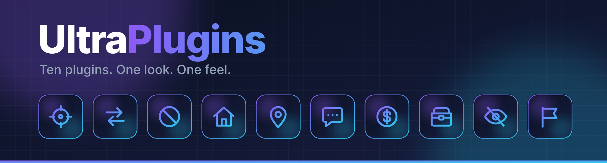
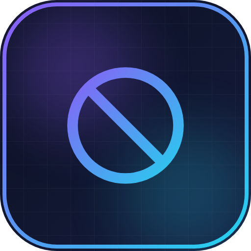
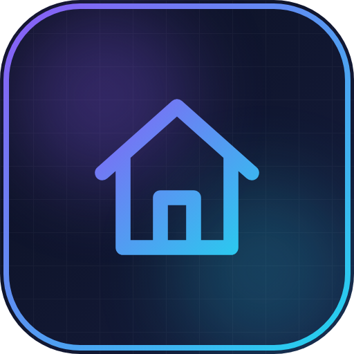
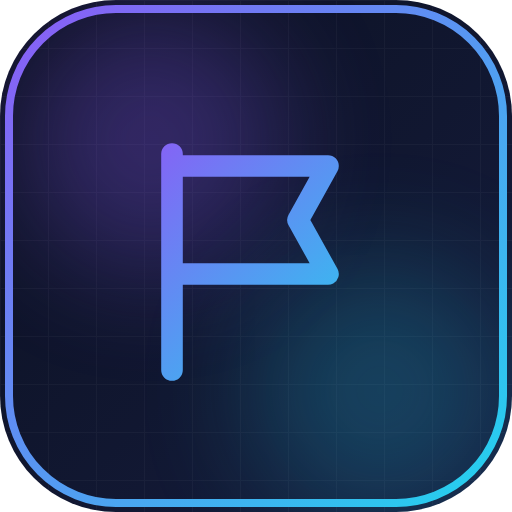

<p align="center"></p>

# UltraPlugins

Eine Serie von Minecraft-Plugins, die sich im Spiel alle gleich anfühlen: gleiche Farben, gleiches
Nachrichten-Layout, gleiche Befehlsstruktur, gleiche Logos. Jedes Plugin hat einen eigenen Ordner.

| | Plugin | Kurzbeschreibung |
| --- | --- | --- |
|  | [**UltraSpawn**](UltraSpawn) | Spawn-Verwaltung, wie sie sein sollte. |
|  | [**UltraTeleports**](UltraTeleports) | Anfragen, Random-Teleport & Back in einem Plugin. |
|  | [**UltraPunish**](UltraPunish) | Saubere Moderation mit GUI, Vorlagen & Historie. |
|  | [**UltraHomes**](UltraHomes) | Homes setzen, verwalten und teilen – in einer GUI. |
|  | [**UltraWarps**](UltraWarps) | Server- und Spieler-Warps mit Kategorien. |
|  | [**UltraChat**](UltraChat) | Formatierung, Kanäle & Moderation für deinen Chat. |
|  | [**UltraEconomy**](UltraEconomy) | Schnelle, Vault-fähige Economy mit mehreren Währungen. |
|  | [**UltraKits**](UltraKits) | Kits mit Vorschau, Cooldowns & Ingame-Editor. |
|  | [**UltraVanish**](UltraVanish) | Echte Unsichtbarkeit für dein Team. |
|  | [**UltraReports**](UltraReports) | Spieler-Reports mit Team-Workflow in der GUI. |

Alle Plugins sprechen **Englisch, Deutsch, Französisch, Niederländisch und Italienisch**. Jeder
Spieler bekommt automatisch die Sprache seines Minecraft-Clients; die Standardsprache stellt man mit
`language:` in der `config.yml` oder im Spiel mit `/ultra<name> language <code>` ein.

## Bauen

Voraussetzungen: Java 17+ und Maven.

```bash
mvn package
```

Danach liegt jedes Plugin als eigenständige Jar in `Ultra<Name>/target/Ultra<Name>-1.0.0.jar`.
Lauffähig auf Spigot, Paper und Purpur, Minecraft 1.20.4 – 26.3. Jede Jar ist eigenständig, es werden keine
weiteren Plugins benötigt (Vault ist optional für Kosten und die Economy-Schnittstelle).

## Aufbau

```
pom.xml                      Maven-Hauptprojekt, baut alle Module
UltraCore/                   Gemeinsamer Code (Nachrichten, Sprachen, GUIs, Teleports), wird in jedes Plugin eingebettet
Ultra<Name>/
  README.md                  Konzept: Features, Befehle, Permissions, Sprachen
  src/                       Quellcode, config.yml, plugin.yml, lang/*.yml
  assets/                    Logo, Banner, Ingame-Vorschau
  release/                   Upload-Material für SpigotMC, BuiltByBit, Modrinth und Hangar
shared/assets/               Serien-Banner und Abschnitts-Header für SpigotMC
tools/                       Generatoren für Assets, Texte und Sprachdateien
DESIGN.md                    Gemeinsames Design-System
```

Die Regeln, die für alle Plugins gelten, stehen in [DESIGN.md](DESIGN.md).

## Übersetzungen ändern

Die Texte aller Sprachen stehen in `tools/lang/<plugin>.txt` (je Schlüssel fünf Zeilen: en, de,
fr, nl, it). `python3 tools/gen_lang.py` schreibt daraus die `lang/*.yml` der Plugins.

## Assets neu erzeugen

Inhalte stehen in `tools/plugins.py`. Nach einer Änderung:

```bash
python3 tools/generate.py && node tools/render.js
```

`render.js` braucht Node mit Playwright und die Schrift Inter. Die erzeugten Dateien werden
überschrieben – Änderungen also in `tools/plugins.py` machen, nicht in den Ausgaben.

## Veröffentlichen

Titel und Taglines aller Plugins stehen in [RELEASE.md](RELEASE.md). Pro Plugin liegt in
`Ultra<Name>/release/` alles für SpigotMC, BuiltByBit, Modrinth und Hangar, inklusive Checkliste.

Die Bilder in den Beschreibungen verweisen auf `raw.githubusercontent.com/.../main/...`. Sie werden
erst angezeigt, wenn dieses Repository öffentlich ist und die Dateien auf `main` liegen. Sonst die
PNGs bei einem Bildhoster hochladen und die Links in den Beschreibungen ersetzen.
