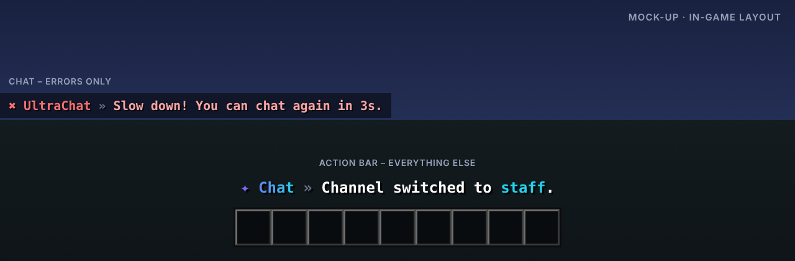

<p align="center"></p>

# UltraChat

> Formatierung, Kanäle & Moderation für deinen Chat.

UltraChat übernimmt den kompletten Chat: Formate pro Rang, Kanäle, Privatnachrichten und ein Filter gegen Spam, Caps und Werbung.

Teil der [Ultra-Serie](../README.md). Layout, Farben und Verhalten folgen dem gemeinsamen
[Design-System](../DESIGN.md).

## Features

- MiniMessage-Formate pro Rang mit Hover- und Klick-Aktionen
- Kanäle: Global, Lokal, Team und eigene
- Privatnachrichten mit /msg und /r, SocialSpy fürs Team
- Filter gegen Beleidigungen, Spam, Caps und Werbung
- Erwähnungen mit Sound, [item] zum Zeigen von Items
- Chat leeren, sperren und Slow-Mode

## Befehle

| Befehl | Beschreibung | Permission |
| --- | --- | --- |
| `/msg <spieler> <text> · /r <text>` | Privatnachrichten | `ultrachat.msg` |
| `/channel [name]` | Kanal wechseln | `ultrachat.channel` |
| `/chatclear` | Chat leeren | `ultrachat.clear` |
| `/mutechat` | Chat sperren / freigeben | `ultrachat.mutechat` |
| `/slowmode <sekunden>` | Slow-Mode setzen | `ultrachat.slowmode` |
| `/socialspy` | Privatnachrichten mitlesen | `ultrachat.socialspy` |
| `/ultrachat <help|reload|version|language>` | Verwaltung | `ultrachat.admin` |

## Weitere Permissions

| Permission | Beschreibung |
| --- | --- |
| `ultrachat.color` | Farben im Chat nutzen |
| `ultrachat.bypass.filter` | Filter umgehen |
| `ultrachat.*` | Alle Rechte des Plugins |

## Ingame-Layout



Rückmeldungen erscheinen in der Actionbar, Fehler im Chat. Auszug aus `lang/en.yml`:

```yaml
channel-switched: "Channel switched to <accent>staff</accent>."
chat-cleared: "Chat cleared by <accent>Alex</accent>."
slowmode: "Slow down! You can chat again in 3s."
```

Das Präfix (`✦ Chat »` bzw. `✖ UltraChat »`) setzt das Plugin automatisch davor.

## Sprachen

Englisch, Deutsch, Französisch, Niederländisch und Italienisch sind eingebaut
(`plugins/UltraChat/lang/en.yml`, `de.yml`, `fr.yml`, `nl.yml`, `it.yml`).

- Jeder Spieler bekommt das Plugin in der Sprache seines Minecraft-Clients
  (`use-client-language: true`). Andere Client-Sprachen erhalten die Standardsprache.
- Standardsprache ändern: `language: de` in der `config.yml` oder im Spiel `/ultrachat language de`.
- Texte lassen sich in den Sprachdateien frei anpassen (MiniMessage). Neue Schlüssel aus Updates
  werden automatisch ergänzt, eigene Änderungen bleiben erhalten.

## Installation

1. `UltraChat-1.0.0.jar` in den Ordner `plugins` legen (Spigot, Paper oder Purpur ab 1.20.4, Java 17+).
   Weitere Plugins oder Bibliotheken werden nicht benötigt.
2. Server neu starten.
3. `config.yml` und die Sprachdateien anpassen, dann `/ultrachat reload`.

Bauen aus dem Quellcode: im Hauptordner `mvn package`, die Jar liegt danach in `UltraChat/target/`.

## Dateien in diesem Ordner

| Datei | Inhalt |
| --- | --- |
| `assets/logo.svg` · `logo.png` | Logo (512 × 512, Resource-Icon auf SpigotMC) |
| `assets/banner.svg` · `banner.png` | Banner (1920 × 480) |
| `assets/preview.png` | Mock-up des Ingame-Layouts |
| `release/` | Upload-Material für SpigotMC, BuiltByBit, Modrinth und Hangar (Titel, Tagline, Beschreibungen, Icons, Banner, Beispielbilder, Checkliste) |
| `src/` | Quellcode, Konfiguration und Sprachdateien |

## Serie

[UltraSpawn](../UltraSpawn) · [UltraTeleports](../UltraTeleports) · [UltraPunish](../UltraPunish) · [UltraHomes](../UltraHomes) · [UltraWarps](../UltraWarps) · [UltraEconomy](../UltraEconomy) · [UltraKits](../UltraKits) · [UltraVanish](../UltraVanish) · [UltraReports](../UltraReports)
