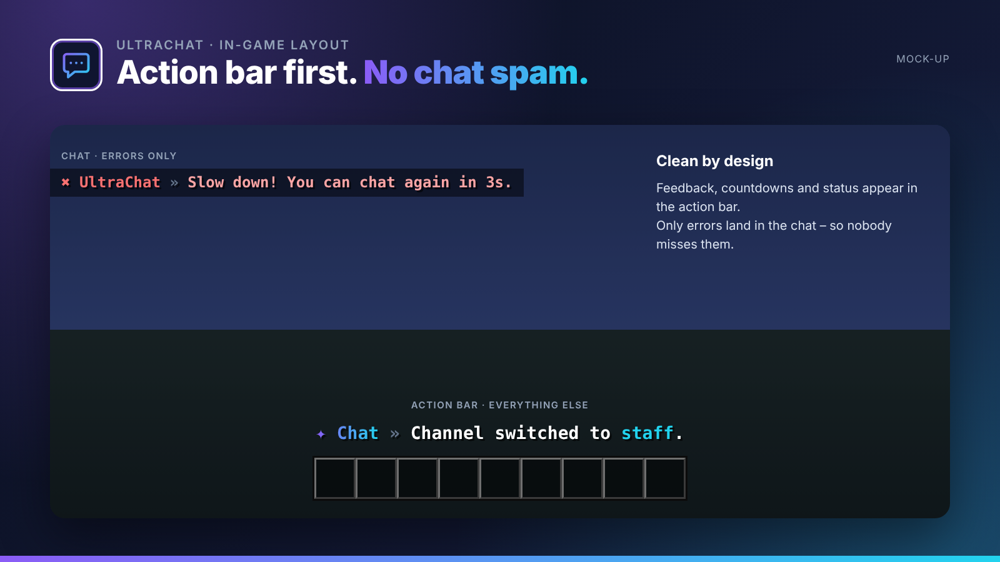

## Formatting, channels & moderation for your chat.

UltraChat takes over the entire chat: formats per rank, channels, private messages and a filter against spam, caps and advertising.

UltraChat is part of the **UltraPlugins** series: every plugin shares the same colours, the same message layout and the same command structure.

## Features

- MiniMessage formats per rank with hover and click actions
- Channels: global, local, staff and custom ones
- Private messages with /msg and /r, social spy for staff
- Filter against swearing, spam, caps and advertising
- Mentions with sound, [item] to show items
- Clear chat, mute chat and slow mode

## In-game layout

No chat spam. Every confirmation, countdown and status appears in the **action bar**. Only **errors** are sent to the chat, so players never miss them. All messages use MiniMessage and can be edited in the language files.

## Languages

**English · Deutsch · Français · Nederlands · Italiano**

Every player sees UltraChat in the language of their Minecraft client – automatically. Players with any other language get your default language, which you set in the config or with `/ultrachat language <code>`. All texts live in `lang/<code>.yml` and can be edited freely.

## Commands

| Command | Description | Permission |
| --- | --- | --- |
| `/msg <spieler> <text> · /r <text>` | Private messages | `ultrachat.msg` |
| `/channel [name]` | Switch channel | `ultrachat.channel` |
| `/chatclear` | Clear the chat | `ultrachat.clear` |
| `/mutechat` | Lock / unlock the chat | `ultrachat.mutechat` |
| `/slowmode <sekunden>` | Set slow mode | `ultrachat.slowmode` |
| `/socialspy` | Read private messages | `ultrachat.socialspy` |
| `/ultrachat <help|reload|version|language>` | Administration | `ultrachat.admin` |

## Permissions

| Permission | Description |
| --- | --- |
| `ultrachat.color` | Use colours in chat |
| `ultrachat.bypass.filter` | Bypass the filter |
| `ultrachat.*` | Everything |

## Supported versions

| | |
| --- | --- |
| Minecraft | **1.20.4 – 26.3** |
| Server | Spigot, Paper and Purpur |
| Java | 17+ (whatever your Minecraft version needs) |

## Installation

1. Drop `UltraChat-1.0.0.jar` into your `plugins` folder. Works on Spigot, Paper and Purpur **1.20.4 – 26.3**, no dependencies needed.
2. Restart your server.
3. Adjust `config.yml` and the files in `lang/`, then run `/ultrachat reload`.

## The Ultra series

- **UltraSpawn** – Spawn management done right.
- **UltraTeleports** – Requests, random teleport & back in one plugin.
- **UltraPunish** – Clean moderation with GUI, templates & history.
- **UltraHomes** – Set, manage and share homes in one GUI.
- **UltraWarps** – Server & player warps with categories.
- **UltraEconomy** – Fast, Vault-ready economy with multiple currencies.
- **UltraKits** – Kits with previews, cooldowns & in-game editor.
- **UltraVanish** – True invisibility for your staff team.
- **UltraReports** – Player reports with a staff GUI workflow.

## Support

Found a bug or have an idea? Please open a report instead of leaving a bad review – we answer every request.
