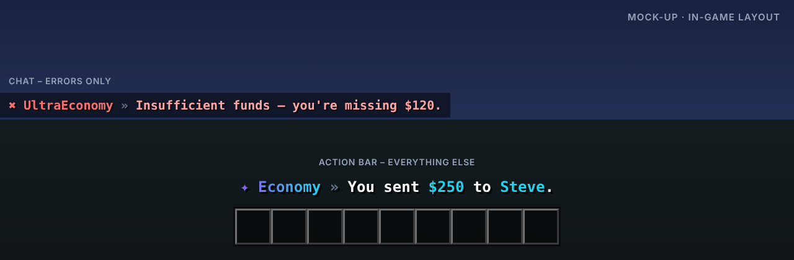

<p align="center"></p>

# UltraEconomy

> Schnelle, Vault-fähige Economy mit mehreren Währungen.

UltraEconomy ist die Wirtschafts-Basis der Serie: Vault-Anbindung, mehrere Währungen, eine Baltop-GUI und ein lückenloses Transaktions-Log.

Teil der [Ultra-Serie](../README.md). Layout, Farben und Verhalten folgen dem gemeinsamen
[Design-System](../DESIGN.md).

## Features

- Vault-Provider, kompatibel mit jedem Vault-Plugin
- Mehrere Währungen (z. B. Coins und Gems)
- /pay mit Bestätigung ab einstellbarem Betrag
- Baltop-GUI mit Spielerköpfen
- Transaktions-Log für jede Buchung
- Bestätigung per Klick für große Überweisungen

## Befehle

| Befehl | Beschreibung | Permission |
| --- | --- | --- |
| `/balance [spieler]` | Kontostand anzeigen | `ultraeconomy.balance` |
| `/pay <spieler> <betrag>` | Geld überweisen | `ultraeconomy.pay` |
| `/baltop` | Öffnet die Rangliste | `ultraeconomy.baltop` |
| `/eco <give|take|set> <spieler> <betrag>` | Kontostände ändern | `ultraeconomy.eco` |
| `/ultraeconomy <help|reload|version|language|log>` | Verwaltung | `ultraeconomy.admin` |

## Weitere Permissions

| Permission | Beschreibung |
| --- | --- |
| `ultraeconomy.balance.others` | Kontostand anderer sehen |
| `ultraeconomy.log` | Transaktions-Log einsehen |
| `ultraeconomy.*` | Alle Rechte des Plugins |

## Ingame-Layout



Rückmeldungen erscheinen in der Actionbar, Fehler im Chat. Auszug aus `lang/en.yml`:

```yaml
pay-sent: "You sent <accent>$250</accent> to <accent>Steve</accent>."
pay-received: "<accent>+ $250</accent> from <accent>Alex</accent>"
insufficient-funds: "Insufficient funds – you're missing $120."
```

Das Präfix (`✦ Economy »` bzw. `✖ UltraEconomy »`) setzt das Plugin automatisch davor.

## Sprachen

Englisch, Deutsch, Französisch, Niederländisch und Italienisch sind eingebaut
(`plugins/UltraEconomy/lang/en.yml`, `de.yml`, `fr.yml`, `nl.yml`, `it.yml`).

- Jeder Spieler bekommt das Plugin in der Sprache seines Minecraft-Clients
  (`use-client-language: true`). Andere Client-Sprachen erhalten die Standardsprache.
- Standardsprache ändern: `language: de` in der `config.yml` oder im Spiel `/ultraeconomy language de`.
- Texte lassen sich in den Sprachdateien frei anpassen (MiniMessage). Neue Schlüssel aus Updates
  werden automatisch ergänzt, eigene Änderungen bleiben erhalten.

## Installation

1. `UltraEconomy-1.0.0.jar` in den Ordner `plugins` legen (Spigot, Paper oder Purpur, Minecraft 1.20.4 – 26.3, Java 17+).
   Weitere Plugins oder Bibliotheken werden nicht benötigt.
2. Server neu starten.
3. `config.yml` und die Sprachdateien anpassen, dann `/ultraeconomy reload`.

Bauen aus dem Quellcode: im Hauptordner `mvn package`, die Jar liegt danach in `UltraEconomy/target/`.

## Dateien in diesem Ordner

| Datei | Inhalt |
| --- | --- |
| `assets/logo.svg` · `logo.png` | Logo (512 × 512, Resource-Icon auf SpigotMC) |
| `assets/banner.svg` · `banner.png` | Banner (1920 × 480) |
| `assets/preview.png` | Mock-up des Ingame-Layouts |
| `release/` | Release: `release.txt` (Titel, Versionstring, Beschreibung), Jar, Changelog, Bilder |
| `src/` | Quellcode, Konfiguration und Sprachdateien |

## Serie

[UltraSpawn](../UltraSpawn) · [UltraTeleports](../UltraTeleports) · [UltraPunish](../UltraPunish) · [UltraHomes](../UltraHomes) · [UltraWarps](../UltraWarps) · [UltraChat](../UltraChat) · [UltraKits](../UltraKits) · [UltraVanish](../UltraVanish) · [UltraReports](../UltraReports) · [UltraRanks](../UltraRanks)
