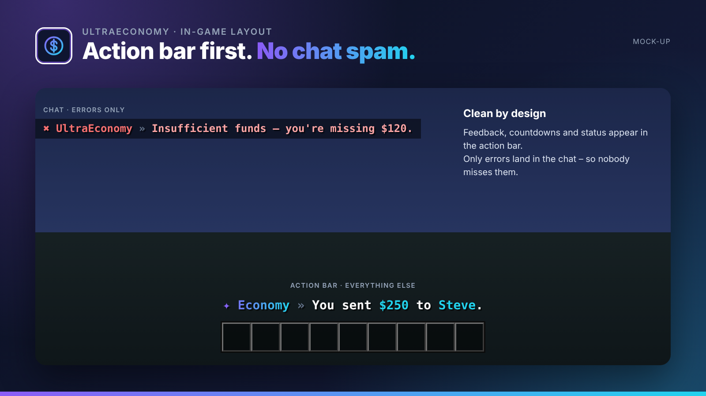
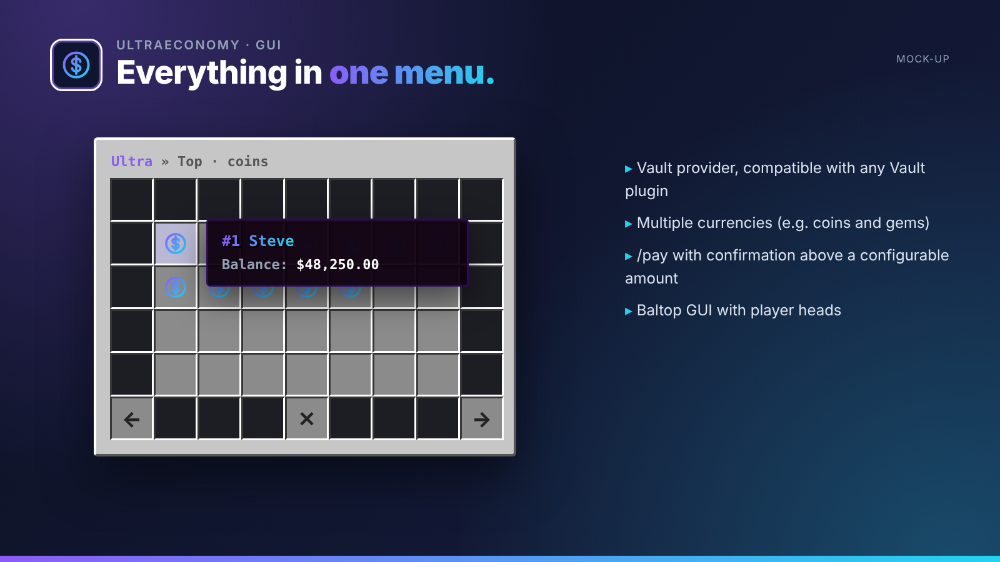
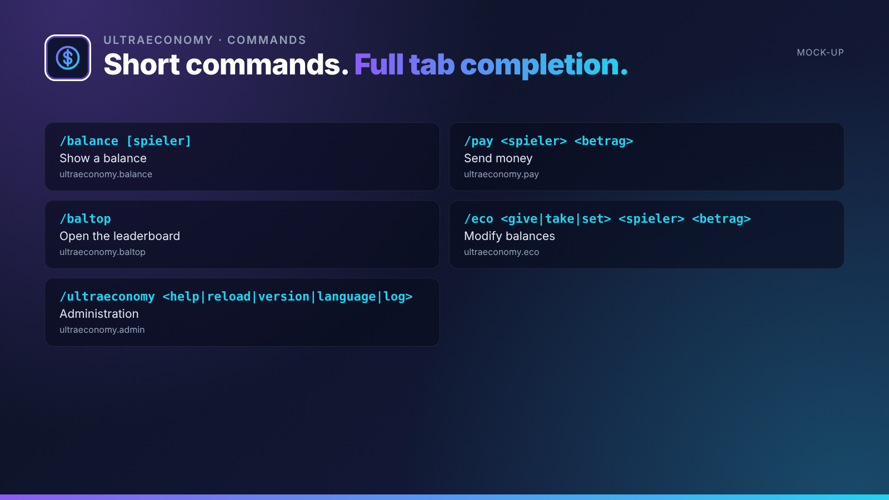

## Fast, Vault-ready economy with multiple currencies.

UltraEconomy is the economy base of the series: Vault support, multiple currencies, a baltop GUI and a complete transaction log.

UltraEconomy is part of the **UltraPlugins** series: every plugin shares the same colours, the same message layout and the same command structure.

## Features

- Vault provider, compatible with any Vault plugin
- Multiple currencies (e.g. coins and gems)
- /pay with confirmation above a configurable amount
- Baltop GUI with player heads
- Transaction log for every booking
- Click-to-confirm for large payments

## In-game layout

No chat spam. Every confirmation, countdown and status appears in the **action bar**. Only **errors** are sent to the chat, so players never miss them. All messages use MiniMessage and can be edited in the language files.

## Languages

**English · Deutsch · Français · Nederlands · Italiano**

Every player sees UltraEconomy in the language of their Minecraft client – automatically. Players with any other language get your default language, which you set in the config or with `/ultraeconomy language <code>`. All texts live in `lang/<code>.yml` and can be edited freely.

## Commands

| Command | Description | Permission |
| --- | --- | --- |
| `/balance [spieler]` | Show a balance | `ultraeconomy.balance` |
| `/pay <spieler> <betrag>` | Send money | `ultraeconomy.pay` |
| `/baltop` | Open the leaderboard | `ultraeconomy.baltop` |
| `/eco <give|take|set> <spieler> <betrag>` | Modify balances | `ultraeconomy.eco` |
| `/ultraeconomy <help|reload|version|language|log>` | Administration | `ultraeconomy.admin` |

## Permissions

| Permission | Description |
| --- | --- |
| `ultraeconomy.balance.others` | See other players' balances |
| `ultraeconomy.log` | View the transaction log |
| `ultraeconomy.*` | Everything |

## Installation

1. Drop `UltraEconomy-1.0.0.jar` into your `plugins` folder. Works on Paper and Purpur 1.20.4+ (Java 17+), no dependencies needed.
2. Restart your server.
3. Adjust `config.yml` and the files in `lang/`, then run `/ultraeconomy reload`.

## The Ultra series

- **UltraSpawn** – Spawn management done right.
- **UltraTeleports** – Requests, random teleport & back in one plugin.
- **UltraPunish** – Clean moderation with GUI, templates & history.
- **UltraHomes** – Set, manage and share homes in one GUI.
- **UltraWarps** – Server & player warps with categories.
- **UltraChat** – Formatting, channels & moderation for your chat.
- **UltraKits** – Kits with previews, cooldowns & in-game editor.
- **UltraVanish** – True invisibility for your staff team.
- **UltraReports** – Player reports with a staff GUI workflow.

## Support

Found a bug or have an idea? Please open a report instead of leaving a bad review – we answer every request.
