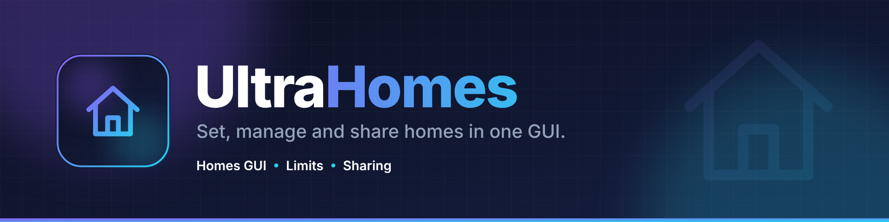
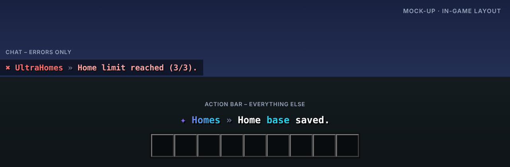

<p align="center"></p>

# UltraHomes

> Homes setzen, verwalten und teilen – in einer GUI.

UltraHomes gibt Spielern ihre Homes in einer aufgeräumten GUI: eigene Icons, Limits per Permission und Homes, die sich mit Freunden teilen lassen.

Teil der [Ultra-Serie](../README.md). Layout, Farben und Verhalten folgen dem gemeinsamen
[Design-System](../DESIGN.md).

## Features

- Homes-GUI mit frei wählbaren Icons
- Limits per Permission (ultrahomes.limit.<anzahl>)
- Umbenennen, verschieben und löschen mit Bestätigung
- Homes öffentlich machen – andere besuchen sie mit /home spieler:name
- Warmup, Cooldown und Welt-Blacklist
- Import aus EssentialsX

## Befehle

| Befehl | Beschreibung | Permission |
| --- | --- | --- |
| `/home [name|spieler:name]` | Teleportiert zu einem Home | `ultrahomes.home` |
| `/homes` | Öffnet die Homes-GUI | `ultrahomes.home` |
| `/sethome [name]` | Setzt ein Home | `ultrahomes.set` |
| `/delhome <name>` | Löscht ein Home | `ultrahomes.delete` |
| `/ultrahomes <help|reload|version|language|import>` | Verwaltung | `ultrahomes.admin` |

## Weitere Permissions

| Permission | Beschreibung |
| --- | --- |
| `ultrahomes.limit.<n>` | Maximale Anzahl Homes |
| `ultrahomes.others` | Homes anderer Spieler verwalten |
| `ultrahomes.*` | Alle Rechte des Plugins |

## Ingame-Layout



Rückmeldungen erscheinen in der Actionbar, Fehler im Chat. Auszug aus `lang/en.yml`:

```yaml
home-set: "Home <accent>base</accent> saved."
home-teleport: "Welcome at <accent>base</accent>."
limit-reached: "Home limit reached (3)."
```

Das Präfix (`✦ Homes »` bzw. `✖ UltraHomes »`) setzt das Plugin automatisch davor.

## Sprachen

Englisch, Deutsch, Französisch, Niederländisch und Italienisch sind eingebaut
(`plugins/UltraHomes/lang/en.yml`, `de.yml`, `fr.yml`, `nl.yml`, `it.yml`).

- Jeder Spieler bekommt das Plugin in der Sprache seines Minecraft-Clients
  (`use-client-language: true`). Andere Client-Sprachen erhalten die Standardsprache.
- Standardsprache ändern: `language: de` in der `config.yml` oder im Spiel `/ultrahomes language de`.
- Texte lassen sich in den Sprachdateien frei anpassen (MiniMessage). Neue Schlüssel aus Updates
  werden automatisch ergänzt, eigene Änderungen bleiben erhalten.

## Installation

1. `UltraHomes-1.0.0.jar` in den Ordner `plugins` legen (Spigot, Paper oder Purpur, Minecraft 1.20.4 – 26.3, Java 17+).
   Weitere Plugins oder Bibliotheken werden nicht benötigt.
2. Server neu starten.
3. `config.yml` und die Sprachdateien anpassen, dann `/ultrahomes reload`.

Bauen aus dem Quellcode: im Hauptordner `mvn package`, die Jar liegt danach in `UltraHomes/target/`.

## Dateien in diesem Ordner

| Datei | Inhalt |
| --- | --- |
| `assets/logo.svg` · `logo.png` | Logo (512 × 512, Resource-Icon auf SpigotMC) |
| `assets/banner.svg` · `banner.png` | Banner (1920 × 480) |
| `assets/preview.png` | Mock-up des Ingame-Layouts |
| `release/` | Upload-Material für SpigotMC, BuiltByBit, Modrinth und Hangar (Titel, Tagline, Beschreibungen, Icons, Banner, Beispielbilder, Checkliste) |
| `src/` | Quellcode, Konfiguration und Sprachdateien |

## Serie

[UltraSpawn](../UltraSpawn) · [UltraTeleports](../UltraTeleports) · [UltraPunish](../UltraPunish) · [UltraWarps](../UltraWarps) · [UltraChat](../UltraChat) · [UltraEconomy](../UltraEconomy) · [UltraKits](../UltraKits) · [UltraVanish](../UltraVanish) · [UltraReports](../UltraReports)
