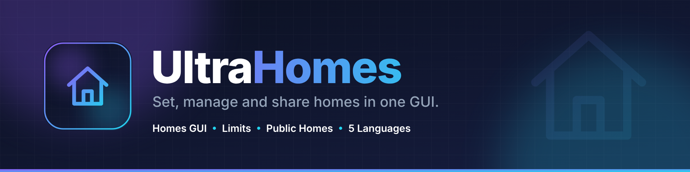
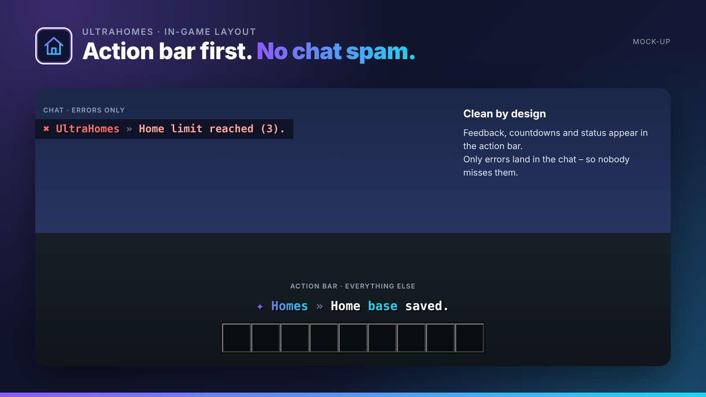
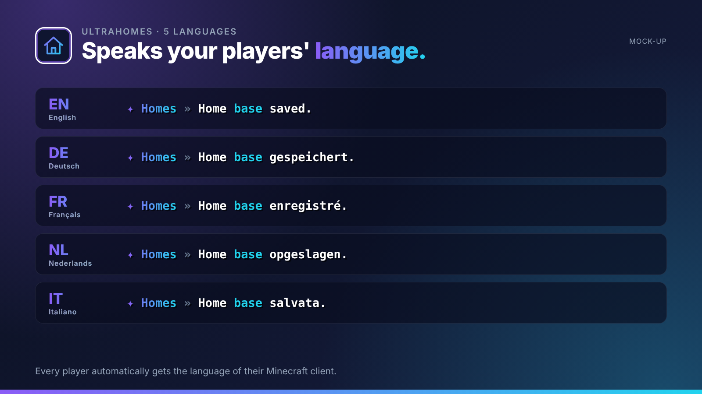
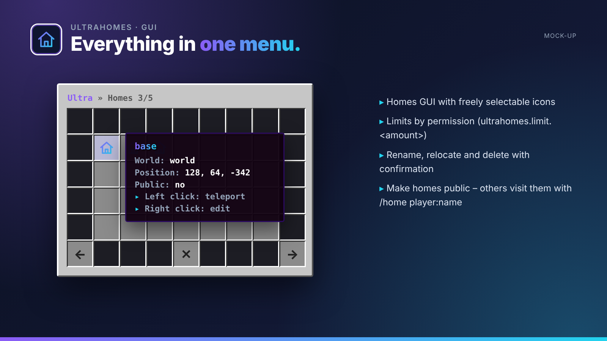
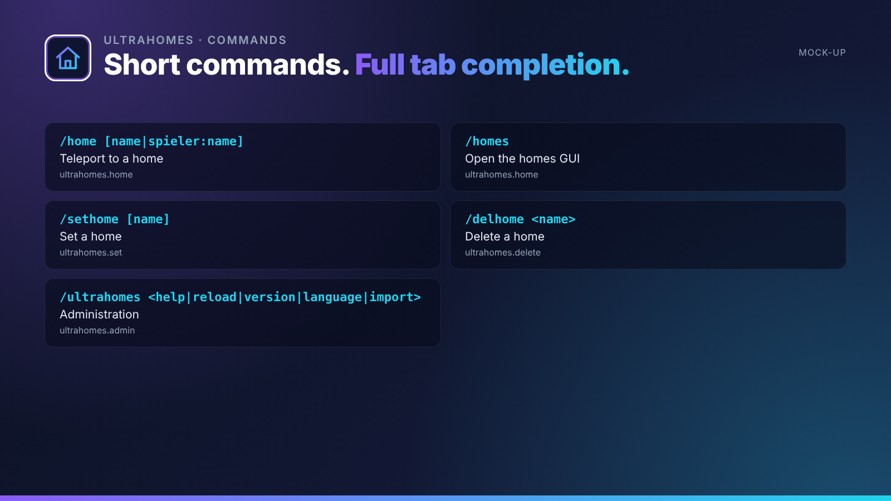

## Set, manage and share homes in one GUI.

UltraHomes gives players their homes in a tidy GUI: custom icons, permission-based limits and homes that can be shared with friends.

UltraHomes is part of the **UltraPlugins** series: every plugin shares the same colours, the same message layout and the same command structure.

## Features

- Homes GUI with freely selectable icons
- Limits by permission (ultrahomes.limit.<amount>)
- Rename, relocate and delete with confirmation
- Make homes public – others visit them with /home player:name
- Warm-up, cooldown and world blacklist
- Import from EssentialsX

## In-game layout

No chat spam. Every confirmation, countdown and status appears in the **action bar**. Only **errors** are sent to the chat, so players never miss them. All messages use MiniMessage and can be edited in the language files.

## Languages

**English · Deutsch · Français · Nederlands · Italiano**

Every player sees UltraHomes in the language of their Minecraft client – automatically. Players with any other language get your default language, which you set in the config or with `/ultrahomes language <code>`. All texts live in `lang/<code>.yml` and can be edited freely.

## Commands

| Command | Description | Permission |
| --- | --- | --- |
| `/home [name|spieler:name]` | Teleport to a home | `ultrahomes.home` |
| `/homes` | Open the homes GUI | `ultrahomes.home` |
| `/sethome [name]` | Set a home | `ultrahomes.set` |
| `/delhome <name>` | Delete a home | `ultrahomes.delete` |
| `/ultrahomes <help|reload|version|language|import>` | Administration | `ultrahomes.admin` |

## Permissions

| Permission | Description |
| --- | --- |
| `ultrahomes.limit.<n>` | Maximum number of homes |
| `ultrahomes.others` | Manage other players' homes |
| `ultrahomes.*` | Everything |

## Installation

1. Drop `UltraHomes-1.0.0.jar` into your `plugins` folder. Works on Paper and Purpur 1.20.4+ (Java 17+), no dependencies needed.
2. Restart your server.
3. Adjust `config.yml` and the files in `lang/`, then run `/ultrahomes reload`.

## The Ultra series

- **UltraSpawn** – Spawn management done right.
- **UltraTeleports** – Requests, random teleport & back in one plugin.
- **UltraPunish** – Clean moderation with GUI, templates & history.
- **UltraWarps** – Server & player warps with categories.
- **UltraChat** – Formatting, channels & moderation for your chat.
- **UltraEconomy** – Fast, Vault-ready economy with multiple currencies.
- **UltraKits** – Kits with previews, cooldowns & in-game editor.
- **UltraVanish** – True invisibility for your staff team.
- **UltraReports** – Player reports with a staff GUI workflow.

## Support

Found a bug or have an idea? Please open a report instead of leaving a bad review – we answer every request.
