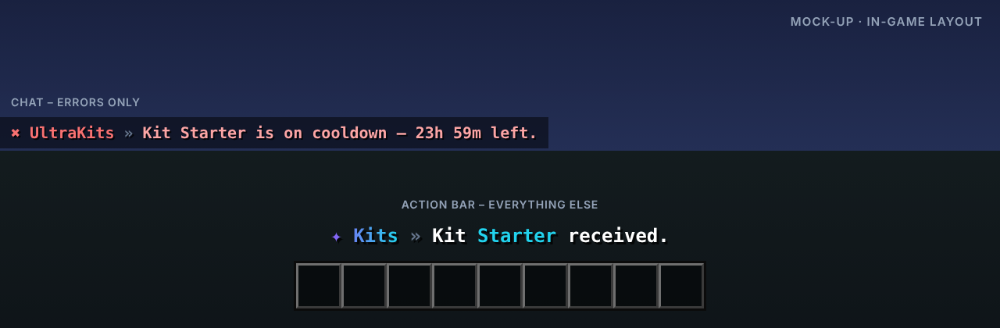

<p align="center"></p>

# UltraKits

> Kits mit Vorschau, Cooldowns & Ingame-Editor.

UltraKits macht Kits einfach: im Spiel aus dem eigenen Inventar erstellen, in einer GUI anbieten und per Cooldown, Preis oder Permission begrenzen.

Teil der [Ultra-Serie](../README.md). Layout, Farben und Verhalten folgen dem gemeinsamen
[Design-System](../DESIGN.md).

## Features

- Kit-GUI mit Vorschau jedes Kits
- Ingame-Editor: Kit direkt aus dem Inventar erstellen
- Cooldowns, Einmal-Kits, Kosten und Permissions
- First-Join-Kit für neue Spieler
- Rüstung wird automatisch angelegt
- Befehle als Kit-Inhalt möglich

## Befehle

| Befehl | Beschreibung | Permission |
| --- | --- | --- |
| `/kit [name]` | Kit abholen | `ultrakits.kit` |
| `/kits` | Öffnet die Kit-GUI | `ultrakits.kit` |
| `/createkit <name>` | Kit aus dem Inventar erstellen | `ultrakits.create` |
| `/editkit <name>` | Kit bearbeiten | `ultrakits.edit` |
| `/delkit <name>` | Kit löschen | `ultrakits.delete` |
| `/ultrakits <help|reload|version>` | Verwaltung | `ultrakits.admin` |

## Weitere Permissions

| Permission | Beschreibung |
| --- | --- |
| `ultrakits.kit.<name>` | Zugriff auf ein bestimmtes Kit |
| `ultrakits.bypass.cooldown` | Kein Cooldown |
| `ultrakits.*` | Alle Rechte des Plugins |

## Ingame-Layout



Rückmeldungen erscheinen in der Actionbar, Fehler im Chat. Auszug aus der `messages.yml`
(Standard: Englisch, `lang/de.yml` liegt bei):

```yaml
actionbar:
  kit-received: "Kit <accent>Starter</accent> received."
  kit-created: "Kit <accent>Miner</accent> created."
error:
  kit-cooldown: "Kit Starter is on cooldown – 23h 59m left."
```

Das Präfix (`✦ Kits »` bzw. `✖ UltraKits »`) setzt das Plugin automatisch davor.

## Dateien in diesem Ordner

| Datei | Inhalt |
| --- | --- |
| `assets/logo.svg` · `logo.png` | Logo (512 × 512, Resource-Icon auf SpigotMC) |
| `assets/banner.svg` · `banner.png` | Banner (1920 × 480) |
| `assets/preview.png` | Mock-up des Ingame-Layouts |
| `spigot/description.bbcode` | Fertige SpigotMC-Beschreibung |

## Serie

[UltraSpawn](../UltraSpawn) · [UltraTeleports](../UltraTeleports) · [UltraPunish](../UltraPunish) · [UltraHomes](../UltraHomes) · [UltraWarps](../UltraWarps) · [UltraChat](../UltraChat) · [UltraEconomy](../UltraEconomy) · [UltraVanish](../UltraVanish) · [UltraReports](../UltraReports)
