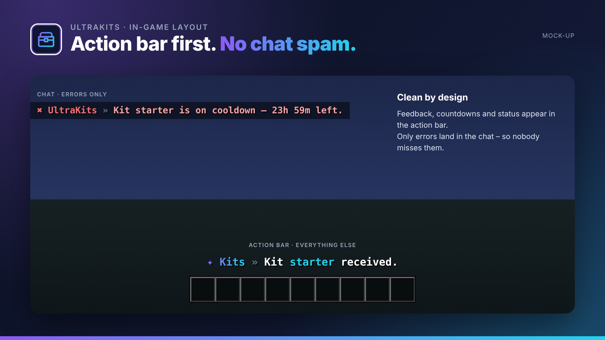
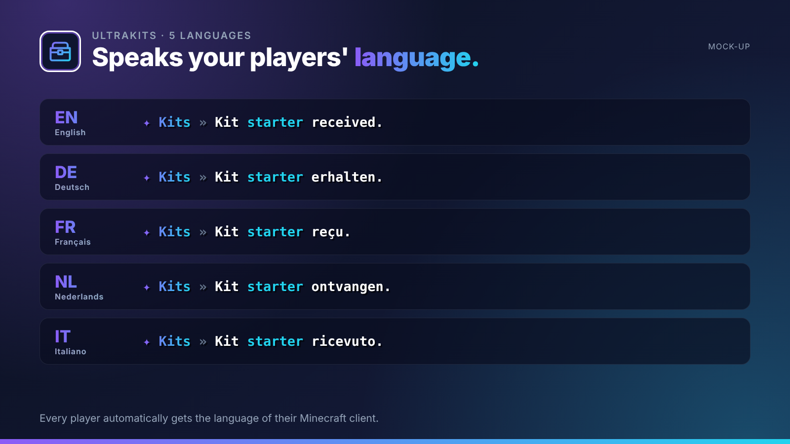
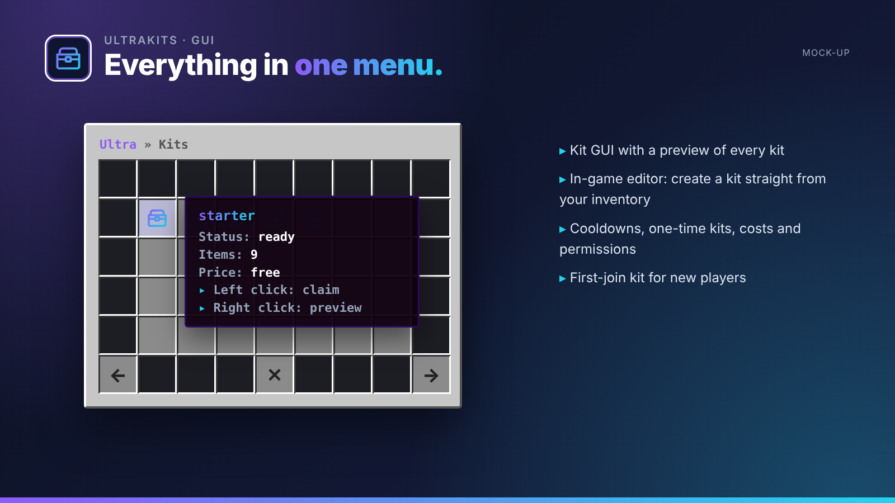
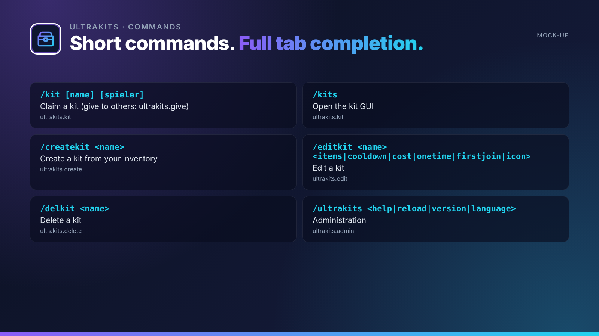

## Kits with previews, cooldowns & in-game editor.

UltraKits makes kits easy: create them in-game from your own inventory, offer them in a GUI and limit them by cooldown, price or permission.

UltraKits is part of the **UltraPlugins** series: every plugin shares the same colours, the same message layout and the same command structure.

## Features

- Kit GUI with a preview of every kit
- In-game editor: create a kit straight from your inventory
- Cooldowns, one-time kits, costs and permissions
- First-join kit for new players
- Armour is equipped automatically
- Kits can run commands as well

## In-game layout

No chat spam. Every confirmation, countdown and status appears in the **action bar**. Only **errors** are sent to the chat, so players never miss them. All messages use MiniMessage and can be edited in the language files.

## Languages

**English · Deutsch · Français · Nederlands · Italiano**

Every player sees UltraKits in the language of their Minecraft client – automatically. Players with any other language get your default language, which you set in the config or with `/ultrakits language <code>`. All texts live in `lang/<code>.yml` and can be edited freely.

## Commands

| Command | Description | Permission |
| --- | --- | --- |
| `/kit [name] [spieler]` | Claim a kit (give to others: ultrakits.give) | `ultrakits.kit` |
| `/kits` | Open the kit GUI | `ultrakits.kit` |
| `/createkit <name>` | Create a kit from your inventory | `ultrakits.create` |
| `/editkit <name> <items|cooldown|cost|onetime|firstjoin|icon>` | Edit a kit | `ultrakits.edit` |
| `/delkit <name>` | Delete a kit | `ultrakits.delete` |
| `/ultrakits <help|reload|version|language>` | Administration | `ultrakits.admin` |

## Permissions

| Permission | Description |
| --- | --- |
| `ultrakits.kit.<name>` | Access to a specific kit |
| `ultrakits.bypass.cooldown` | Skip the cooldown |
| `ultrakits.*` | Everything |

## Installation

1. Drop `UltraKits-1.0.0.jar` into your `plugins` folder. Works on Paper and Purpur 1.20.4+ (Java 17+), no dependencies needed.
2. Restart your server.
3. Adjust `config.yml` and the files in `lang/`, then run `/ultrakits reload`.

## The Ultra series

- **UltraSpawn** – Spawn management done right.
- **UltraTeleports** – Requests, random teleport & back in one plugin.
- **UltraPunish** – Clean moderation with GUI, templates & history.
- **UltraHomes** – Set, manage and share homes in one GUI.
- **UltraWarps** – Server & player warps with categories.
- **UltraChat** – Formatting, channels & moderation for your chat.
- **UltraEconomy** – Fast, Vault-ready economy with multiple currencies.
- **UltraVanish** – True invisibility for your staff team.
- **UltraReports** – Player reports with a staff GUI workflow.

## Support

Found a bug or have an idea? Please open a report instead of leaving a bad review – we answer every request.
