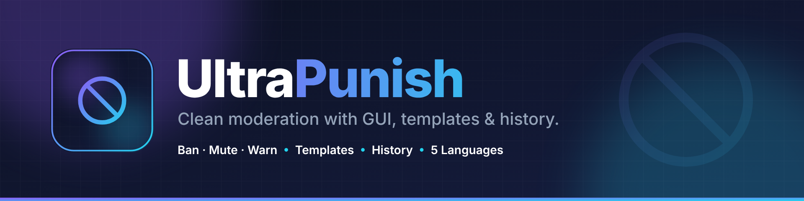
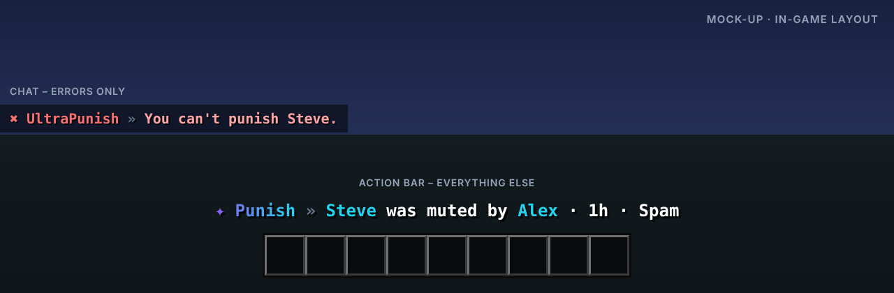

<p align="center"></p>

# UltraPunish

> Saubere Moderation mit GUI, Vorlagen & Historie.

UltraPunish ist das Moderations-Plugin der Serie: Bans, Mutes, Kicks und Verwarnungen über Befehle oder eine übersichtliche GUI mit Grund-Vorlagen und automatisch steigenden Strafen.

Teil der [Ultra-Serie](../README.md). Layout, Farben und Verhalten folgen dem gemeinsamen
[Design-System](../DESIGN.md).

## Features

- Ban, Tempban, Mute, Tempmute, Kick und Warn
- Punish-GUI mit Grund-Vorlagen und eskalierenden Dauern
- Vollständige Historie pro Spieler
- IP-Bans und Alt-Account-Erkennung
- Strafen werden jedem Spieler in seiner Sprache angezeigt, auch auf dem Ban-Screen
- Team-Benachrichtigungen und automatische Aktionen ab X Verwarnungen

## Befehle

| Befehl | Beschreibung | Permission |
| --- | --- | --- |
| `/punish <spieler>` | Öffnet die Punish-GUI | `ultrapunish.gui` |
| `/ban · /tempban <spieler> [dauer] [grund]` | Spieler bannen | `ultrapunish.ban` |
| `/mute · /tempmute <spieler> [dauer] [grund]` | Spieler muten | `ultrapunish.mute` |
| `/banip <spieler> [grund]` | Spieler samt IP bannen | `ultrapunish.ban` |
| `/kick <spieler> [grund]` | Spieler kicken | `ultrapunish.kick` |
| `/warn <spieler> [grund]` | Spieler verwarnen | `ultrapunish.warn` |
| `/unban · /unmute <spieler>` | Strafe aufheben | `ultrapunish.revoke` |
| `/history <spieler>` | Historie anzeigen | `ultrapunish.history` |
| `/ultrapunish <help|reload|version|language>` | Verwaltung | `ultrapunish.admin` |

## Weitere Permissions

| Permission | Beschreibung |
| --- | --- |
| `ultrapunish.notify` | Erhält Team-Benachrichtigungen |
| `ultrapunish.exempt` | Kann nicht bestraft werden |
| `ultrapunish.*` | Alle Rechte des Plugins |

## Ingame-Layout



Rückmeldungen erscheinen in der Actionbar, Fehler im Chat. Auszug aus `lang/en.yml`:

```yaml
notify-mute: "<accent>Steve</accent> was muted by <accent>Alex</accent> · 1h · Spam"
notify-unban: "<accent>Steve</accent> was unbanned by <accent>Alex</accent>."
target-exempt: "You can't punish Steve."
```

Das Präfix (`✦ Punish »` bzw. `✖ UltraPunish »`) setzt das Plugin automatisch davor.

## Sprachen

Englisch, Deutsch, Französisch, Niederländisch und Italienisch sind eingebaut
(`plugins/UltraPunish/lang/en.yml`, `de.yml`, `fr.yml`, `nl.yml`, `it.yml`).

- Jeder Spieler bekommt das Plugin in der Sprache seines Minecraft-Clients
  (`use-client-language: true`). Andere Client-Sprachen erhalten die Standardsprache.
- Standardsprache ändern: `language: de` in der `config.yml` oder im Spiel `/ultrapunish language de`.
- Texte lassen sich in den Sprachdateien frei anpassen (MiniMessage). Neue Schlüssel aus Updates
  werden automatisch ergänzt, eigene Änderungen bleiben erhalten.

## Installation

1. `UltraPunish-1.0.0.jar` in den Ordner `plugins` legen (Paper 1.20.4 oder neuer, Java 17+).
2. Server neu starten.
3. `config.yml` und die Sprachdateien anpassen, dann `/ultrapunish reload`.

Bauen aus dem Quellcode: im Hauptordner `mvn package`, die Jar liegt danach in `UltraPunish/target/`.

## Dateien in diesem Ordner

| Datei | Inhalt |
| --- | --- |
| `assets/logo.svg` · `logo.png` | Logo (512 × 512, Resource-Icon auf SpigotMC) |
| `assets/banner.svg` · `banner.png` | Banner (1920 × 480) |
| `assets/preview.png` | Mock-up des Ingame-Layouts |
| `spigot/description.bbcode` | Fertige SpigotMC-Beschreibung |
| `src/` | Quellcode, Konfiguration und Sprachdateien |

## Serie

[UltraSpawn](../UltraSpawn) · [UltraTeleports](../UltraTeleports) · [UltraHomes](../UltraHomes) · [UltraWarps](../UltraWarps) · [UltraChat](../UltraChat) · [UltraEconomy](../UltraEconomy) · [UltraKits](../UltraKits) · [UltraVanish](../UltraVanish) · [UltraReports](../UltraReports)
