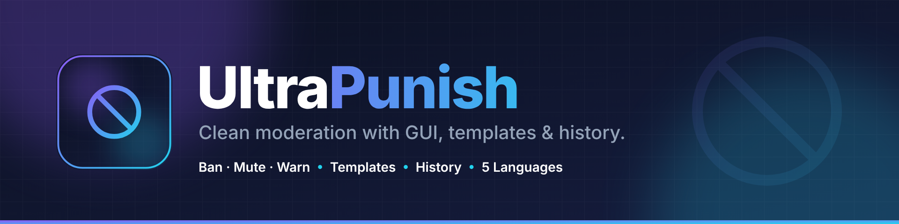
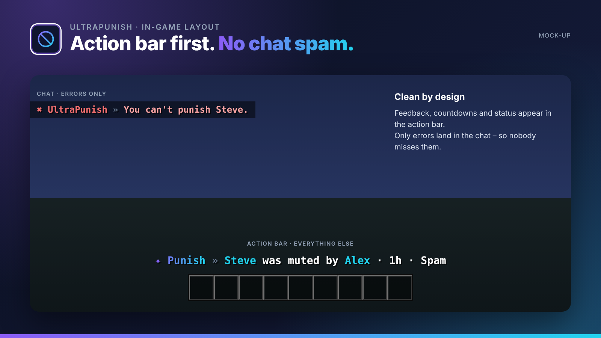
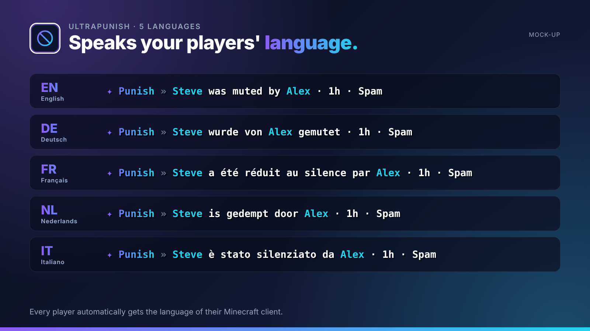
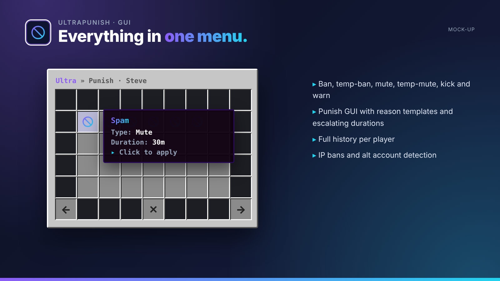
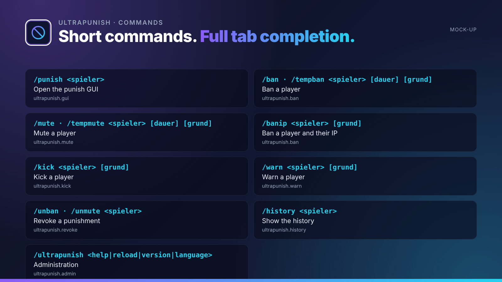

## Clean moderation with GUI, templates & history.

UltraPunish is the moderation plugin of the series: bans, mutes, kicks and warnings via commands or a clean GUI with reason templates and automatically escalating punishments.

UltraPunish is part of the **UltraPlugins** series: every plugin shares the same colours, the same message layout and the same command structure.

## Features

- Ban, temp-ban, mute, temp-mute, kick and warn
- Punish GUI with reason templates and escalating durations
- Full history per player
- IP bans and alt account detection
- Punishments are shown in each player's language, ban screen included
- Staff notifications and automatic actions after X warnings

## In-game layout

No chat spam. Every confirmation, countdown and status appears in the **action bar**. Only **errors** are sent to the chat, so players never miss them. All messages use MiniMessage and can be edited in the language files.

## Languages

**English · Deutsch · Français · Nederlands · Italiano**

Every player sees UltraPunish in the language of their Minecraft client – automatically. Players with any other language get your default language, which you set in the config or with `/ultrapunish language <code>`. All texts live in `lang/<code>.yml` and can be edited freely.

## Commands

| Command | Description | Permission |
| --- | --- | --- |
| `/punish <spieler>` | Open the punish GUI | `ultrapunish.gui` |
| `/ban · /tempban <spieler> [dauer] [grund]` | Ban a player | `ultrapunish.ban` |
| `/mute · /tempmute <spieler> [dauer] [grund]` | Mute a player | `ultrapunish.mute` |
| `/banip <spieler> [grund]` | Ban a player and their IP | `ultrapunish.ban` |
| `/kick <spieler> [grund]` | Kick a player | `ultrapunish.kick` |
| `/warn <spieler> [grund]` | Warn a player | `ultrapunish.warn` |
| `/unban · /unmute <spieler>` | Revoke a punishment | `ultrapunish.revoke` |
| `/history <spieler>` | Show the history | `ultrapunish.history` |
| `/ultrapunish <help|reload|version|language>` | Administration | `ultrapunish.admin` |

## Permissions

| Permission | Description |
| --- | --- |
| `ultrapunish.notify` | Receive staff notifications |
| `ultrapunish.exempt` | Cannot be punished |
| `ultrapunish.*` | Everything |

## Installation

1. Drop `UltraPunish-1.0.0.jar` into your `plugins` folder. Works on Paper and Purpur 1.20.4+ (Java 17+), no dependencies needed.
2. Restart your server.
3. Adjust `config.yml` and the files in `lang/`, then run `/ultrapunish reload`.

## The Ultra series

- **UltraSpawn** – Spawn management done right.
- **UltraTeleports** – Requests, random teleport & back in one plugin.
- **UltraHomes** – Set, manage and share homes in one GUI.
- **UltraWarps** – Server & player warps with categories.
- **UltraChat** – Formatting, channels & moderation for your chat.
- **UltraEconomy** – Fast, Vault-ready economy with multiple currencies.
- **UltraKits** – Kits with previews, cooldowns & in-game editor.
- **UltraVanish** – True invisibility for your staff team.
- **UltraReports** – Player reports with a staff GUI workflow.

## Support

Found a bug or have an idea? Please open a report instead of leaving a bad review – we answer every request.
