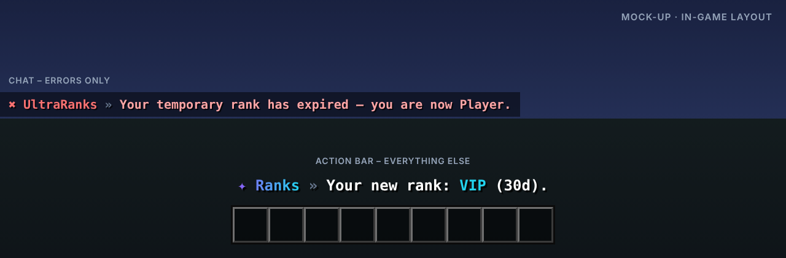

<p align="center"></p>

# UltraRanks

> Ränge mit GUI-Editor, Prefixen, Tabliste und Rechten.

UltraRanks ist das Rang- und Rechte-System der Serie: Ränge im GUI erstellen und bearbeiten, Prefix, Suffix und Rangstärke festlegen, Rechte per Amboss eintippen und Tabliste, Nametag und Chat einheitlich gestalten.

Teil der [Ultra-Serie](../README.md). Layout, Farben und Verhalten folgen dem gemeinsamen
[Design-System](../DESIGN.md).

## Features

- Admin-GUI zum Erstellen, Bearbeiten und Löschen von Rängen
- Prefix, Suffix, Rangstärke, Namensfarbe und Icon pro Rang
- Rechte per Plus-Button und Amboss-Eingabe, aktivieren, verbieten, löschen
- Tabliste sortiert nach Rangstärke, Nametag über dem Kopf und Chat-Format
- Spieler-GUI: eigener Rang, alle Ränge und deren Rechte
- Zeitränge, Vererbung, Rang-Kauf, Gutscheine, Vault, PlaceholderAPI, LuckPerms-Import

## Befehle

| Befehl | Beschreibung | Permission |
| --- | --- | --- |
| `/ranks` | Eigener Rang und alle Ränge | `ultraranks.use` |
| `/rankadmin` | Rang-Editor öffnen | `ultraranks.manage` |
| `/rank set <spieler> <rang> [dauer]` | Rang vergeben, optional auf Zeit | `ultraranks.manage` |
| `/rank perm <rang> <recht> [true|false|remove]` | Rechte per Befehl | `ultraranks.manage` |
| `/rank voucher <rang> [dauer] [spieler]` | Rang-Gutschein erstellen | `ultraranks.manage` |
| `/ultraranks <help|reload|version|language|import>` | Verwaltung und LuckPerms-Import | `ultraranks.admin` |

## Weitere Permissions

| Permission | Beschreibung |
| --- | --- |
| `ultraranks.chat.color` | &-Farbcodes im Chat |
| `ultraranks.*` | Alle Rechte des Plugins |

## Ingame-Layout



Rückmeldungen erscheinen in der Actionbar, Fehler im Chat. Auszug aus `lang/en.yml`:

```yaml
rank-received: "Your new rank: <accent>VIP</accent> (30d)."
perm-added: "<accent>essentials.fly</accent> added to VIP."
rank-expired: "Your temporary rank has expired – you are now Player."
```

Das Präfix (`✦ Ranks »` bzw. `✖ UltraRanks »`) setzt das Plugin automatisch davor.

## Sprachen

Englisch, Deutsch, Französisch, Niederländisch und Italienisch sind eingebaut
(`plugins/UltraRanks/lang/en.yml`, `de.yml`, `fr.yml`, `nl.yml`, `it.yml`).

- Jeder Spieler bekommt das Plugin in der Sprache seines Minecraft-Clients
  (`use-client-language: true`). Andere Client-Sprachen erhalten die Standardsprache.
- Standardsprache ändern: `language: de` in der `config.yml` oder im Spiel `/ultraranks language de`.
- Texte lassen sich in den Sprachdateien frei anpassen (MiniMessage). Neue Schlüssel aus Updates
  werden automatisch ergänzt, eigene Änderungen bleiben erhalten.

## Installation

1. `UltraRanks-1.0.0.jar` in den Ordner `plugins` legen (Spigot, Paper oder Purpur, Minecraft 1.20.4 – 26.3, Java 17+).
   Weitere Plugins oder Bibliotheken werden nicht benötigt.
2. Server neu starten.
3. `config.yml` und die Sprachdateien anpassen, dann `/ultraranks reload`.

Bauen aus dem Quellcode: im Hauptordner `mvn package`, die Jar liegt danach in `UltraRanks/target/`.

## Dateien in diesem Ordner

| Datei | Inhalt |
| --- | --- |
| `assets/logo.svg` · `logo.png` | Logo (512 × 512, Resource-Icon auf SpigotMC) |
| `assets/banner.svg` · `banner.png` | Banner (1920 × 480) |
| `assets/preview.png` | Mock-up des Ingame-Layouts |
| `release/` | Release: `release.txt` (Titel, Versionstring, Beschreibung), Jar, Changelog, Bilder |
| `src/` | Quellcode, Konfiguration und Sprachdateien |

## Serie

[UltraSpawn](../UltraSpawn) · [UltraTeleports](../UltraTeleports) · [UltraPunish](../UltraPunish) · [UltraHomes](../UltraHomes) · [UltraWarps](../UltraWarps) · [UltraChat](../UltraChat) · [UltraEconomy](../UltraEconomy) · [UltraKits](../UltraKits) · [UltraVanish](../UltraVanish) · [UltraReports](../UltraReports)
