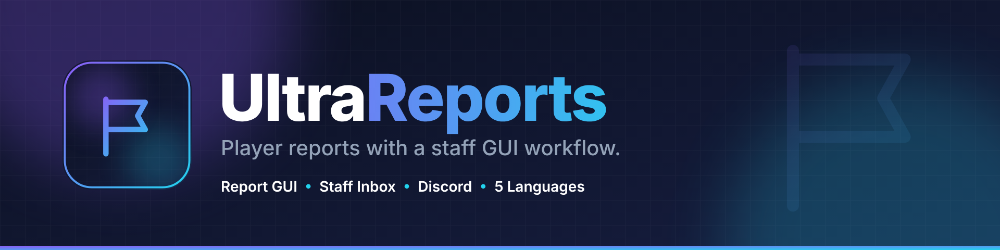
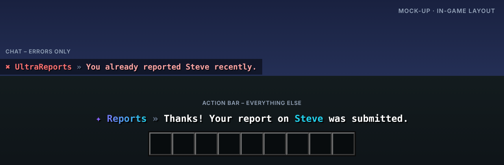

<p align="center"></p>

# UltraReports

> Spieler-Reports mit Team-Workflow in der GUI.

UltraReports gibt Spielern eine einfache Möglichkeit, Regelverstöße zu melden, und dem Team einen Posteingang, in dem jeder Report übernommen, bearbeitet und abgeschlossen wird.

Teil der [Ultra-Serie](../README.md). Layout, Farben und Verhalten folgen dem gemeinsamen
[Design-System](../DESIGN.md).

## Features

- Report-GUI mit konfigurierbaren Gründen
- Team-Posteingang mit Status: offen, in Bearbeitung, erledigt
- Report übernehmen und direkt zum Spieler teleportieren
- Cooldown und Schutz vor Missbrauch
- Discord-Webhook für neue Reports
- Mit UltraPunish direkt aus dem Report bestrafen

## Befehle

| Befehl | Beschreibung | Permission |
| --- | --- | --- |
| `/report <spieler> [grund]` | Spieler melden | `ultrareports.report` |
| `/reports [id]` | Öffnet den Team-Posteingang oder einen Report | `ultrareports.staff` |
| `/ultrareports <help|reload|version|language>` | Verwaltung | `ultrareports.admin` |

## Weitere Permissions

| Permission | Beschreibung |
| --- | --- |
| `ultrareports.notify` | Erhält Benachrichtigungen über neue Reports |
| `ultrareports.bypass.cooldown` | Kein Cooldown |
| `ultrareports.*` | Alle Rechte des Plugins |

## Ingame-Layout



Rückmeldungen erscheinen in der Actionbar, Fehler im Chat. Auszug aus `lang/en.yml`:

```yaml
report-sent: "Thanks! Your report on <accent>Steve</accent> was submitted."
report-claimed: "You claimed report <accent>#42</accent>."
already-reported: "You already reported Steve – staff is on it."
```

Das Präfix (`✦ Reports »` bzw. `✖ UltraReports »`) setzt das Plugin automatisch davor.

## Sprachen

Englisch, Deutsch, Französisch, Niederländisch und Italienisch sind eingebaut
(`plugins/UltraReports/lang/en.yml`, `de.yml`, `fr.yml`, `nl.yml`, `it.yml`).

- Jeder Spieler bekommt das Plugin in der Sprache seines Minecraft-Clients
  (`use-client-language: true`). Andere Client-Sprachen erhalten die Standardsprache.
- Standardsprache ändern: `language: de` in der `config.yml` oder im Spiel `/ultrareports language de`.
- Texte lassen sich in den Sprachdateien frei anpassen (MiniMessage). Neue Schlüssel aus Updates
  werden automatisch ergänzt, eigene Änderungen bleiben erhalten.

## Installation

1. `UltraReports-1.0.0.jar` in den Ordner `plugins` legen (Spigot, Paper oder Purpur, Minecraft 1.20.4 – 26.3, Java 17+).
   Weitere Plugins oder Bibliotheken werden nicht benötigt.
2. Server neu starten.
3. `config.yml` und die Sprachdateien anpassen, dann `/ultrareports reload`.

Bauen aus dem Quellcode: im Hauptordner `mvn package`, die Jar liegt danach in `UltraReports/target/`.

## Dateien in diesem Ordner

| Datei | Inhalt |
| --- | --- |
| `assets/logo.svg` · `logo.png` | Logo (512 × 512, Resource-Icon auf SpigotMC) |
| `assets/banner.svg` · `banner.png` | Banner (1920 × 480) |
| `assets/preview.png` | Mock-up des Ingame-Layouts |
| `release/` | Release: `release.txt` (Titel, Versionstring, Beschreibung), Jar, Changelog, Bilder |
| `src/` | Quellcode, Konfiguration und Sprachdateien |

## Serie

[UltraSpawn](../UltraSpawn) · [UltraTeleports](../UltraTeleports) · [UltraPunish](../UltraPunish) · [UltraHomes](../UltraHomes) · [UltraWarps](../UltraWarps) · [UltraChat](../UltraChat) · [UltraEconomy](../UltraEconomy) · [UltraKits](../UltraKits) · [UltraVanish](../UltraVanish) · [UltraRanks](../UltraRanks)
