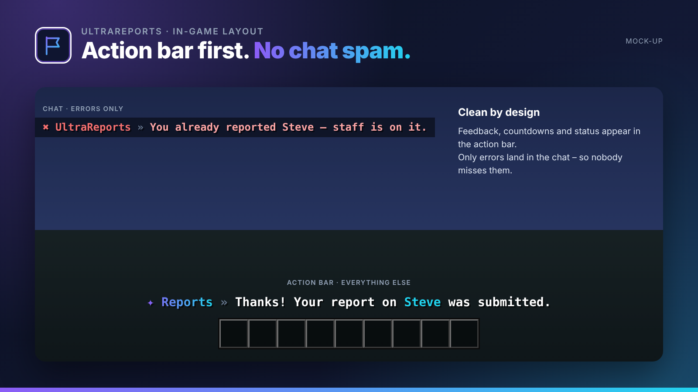

## Player reports with a staff GUI workflow.

UltraReports gives players an easy way to report rule breakers and gives staff an inbox where every report is claimed, handled and closed.

UltraReports is part of the **UltraPlugins** series: every plugin shares the same colours, the same message layout and the same command structure.

## Features

- Report GUI with configurable reasons
- Staff inbox with status: open, in progress, closed
- Claim a report and teleport straight to the player
- Cooldown and abuse protection
- Discord webhook for new reports
- Punish straight from the report with UltraPunish

## In-game layout

No chat spam. Every confirmation, countdown and status appears in the **action bar**. Only **errors** are sent to the chat, so players never miss them. All messages use MiniMessage and can be edited in the language files.

## Languages

**English · Deutsch · Français · Nederlands · Italiano**

Every player sees UltraReports in the language of their Minecraft client – automatically. Players with any other language get your default language, which you set in the config or with `/ultrareports language <code>`. All texts live in `lang/<code>.yml` and can be edited freely.

## Commands

| Command | Description | Permission |
| --- | --- | --- |
| `/report <spieler> [grund]` | Report a player | `ultrareports.report` |
| `/reports [id]` | Open the staff inbox or one report | `ultrareports.staff` |
| `/ultrareports <help|reload|version|language>` | Administration | `ultrareports.admin` |

## Permissions

| Permission | Description |
| --- | --- |
| `ultrareports.notify` | Receive notifications about new reports |
| `ultrareports.bypass.cooldown` | Skip the cooldown |
| `ultrareports.*` | Everything |

## Supported versions

| | |
| --- | --- |
| Minecraft | **1.20.4 – 26.3** |
| Server | Spigot, Paper and Purpur |
| Java | 17+ (whatever your Minecraft version needs) |

## Installation

1. Drop `UltraReports-1.0.0.jar` into your `plugins` folder. Works on Spigot, Paper and Purpur **1.20.4 – 26.3**, no dependencies needed.
2. Restart your server.
3. Adjust `config.yml` and the files in `lang/`, then run `/ultrareports reload`.

## The Ultra series

- **UltraSpawn** – Spawn management done right.
- **UltraTeleports** – Requests, random teleport & back in one plugin.
- **UltraPunish** – Clean moderation with GUI, templates & history.
- **UltraHomes** – Set, manage and share homes in one GUI.
- **UltraWarps** – Server & player warps with categories.
- **UltraChat** – Formatting, channels & moderation for your chat.
- **UltraEconomy** – Fast, Vault-ready economy with multiple currencies.
- **UltraKits** – Kits with previews, cooldowns & in-game editor.
- **UltraVanish** – True invisibility for your staff team.

## Support

Found a bug or have an idea? Please open a report instead of leaving a bad review – we answer every request.
