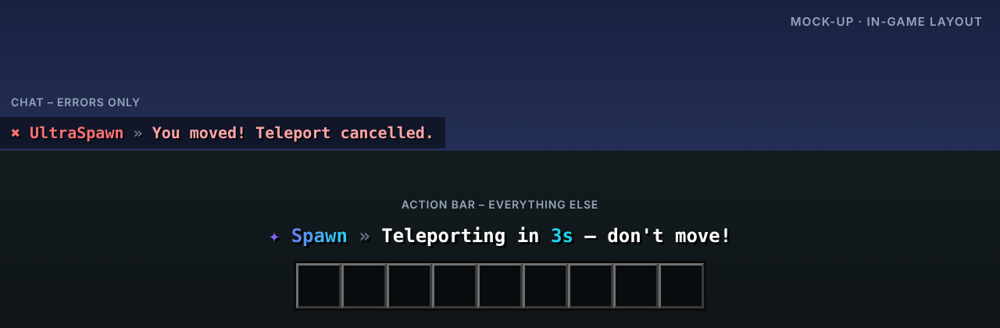

<p align="center"></p>

# UltraSpawn

> Spawn-Verwaltung, wie sie sein sollte.

UltraSpawn kümmert sich um alles rund um den Spawn: ein oder mehrere Spawnpunkte, ein eigener Spawn für neue Spieler und automatisches Teleportieren bei Join, Tod oder Sturz ins Void.

Teil der [Ultra-Serie](../README.md). Layout, Farben und Verhalten folgen dem gemeinsamen
[Design-System](../DESIGN.md).

## Features

- Mehrere Spawns pro Welt oder Rang (z. B. VIP-Spawn)
- Eigener First-Join-Spawn für neue Spieler
- Teleport bei Join, Respawn und Void einzeln schaltbar
- Warmup-Countdown in der Actionbar, Abbruch bei Bewegung oder Schaden
- Cooldowns und Bypass-Permissions
- Void-Rescue: kein Tod mehr in der Lobby

## Befehle

| Befehl | Beschreibung | Permission |
| --- | --- | --- |
| `/spawn [spieler]` | Teleportiert zum Spawn (andere: ultraspawn.spawn.others) | `ultraspawn.spawn` |
| `/setspawn [name]` | Setzt einen Spawnpunkt | `ultraspawn.set` |
| `/delspawn <name>` | Löscht einen Spawnpunkt | `ultraspawn.delete` |
| `/ultraspawn <help|reload|version>` | Verwaltung | `ultraspawn.admin` |

## Weitere Permissions

| Permission | Beschreibung |
| --- | --- |
| `ultraspawn.bypass.warmup` | Kein Warmup |
| `ultraspawn.bypass.cooldown` | Kein Cooldown |
| `ultraspawn.*` | Alle Rechte des Plugins |

## Ingame-Layout



Rückmeldungen erscheinen in der Actionbar, Fehler im Chat. Auszug aus der `messages.yml`
(Standard: Englisch, `lang/de.yml` liegt bei):

```yaml
actionbar:
  teleport-warmup: "Teleporting in <accent>3s</accent> – don't move!"
  teleport-success: "Welcome back at <accent>spawn</accent>."
error:
  teleport-cancelled: "You moved! Teleport cancelled."
```

Das Präfix (`✦ Spawn »` bzw. `✖ UltraSpawn »`) setzt das Plugin automatisch davor.

## Dateien in diesem Ordner

| Datei | Inhalt |
| --- | --- |
| `assets/logo.svg` · `logo.png` | Logo (512 × 512, Resource-Icon auf SpigotMC) |
| `assets/banner.svg` · `banner.png` | Banner (1920 × 480) |
| `assets/preview.png` | Mock-up des Ingame-Layouts |
| `spigot/description.bbcode` | Fertige SpigotMC-Beschreibung |

## Serie

[UltraTeleports](../UltraTeleports) · [UltraPunish](../UltraPunish) · [UltraHomes](../UltraHomes) · [UltraWarps](../UltraWarps) · [UltraChat](../UltraChat) · [UltraEconomy](../UltraEconomy) · [UltraKits](../UltraKits) · [UltraVanish](../UltraVanish) · [UltraReports](../UltraReports)
