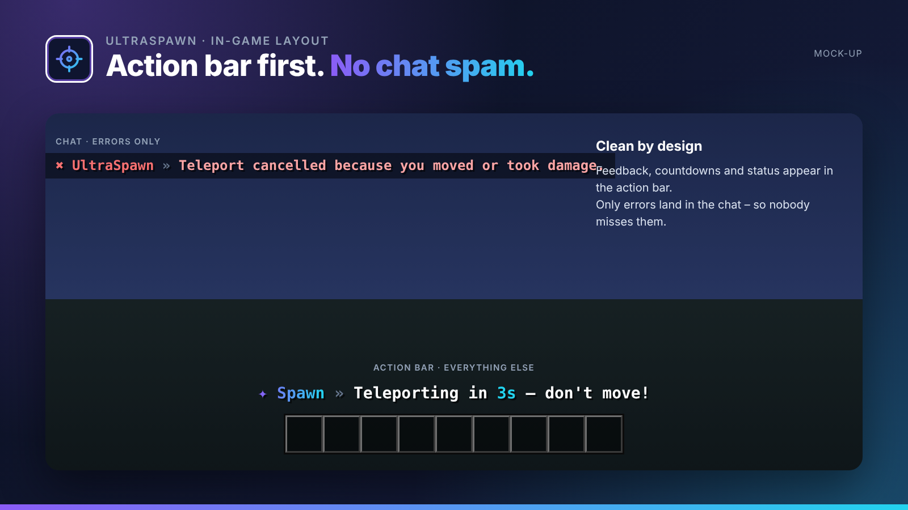

## Spawn management done right.

UltraSpawn handles everything around your spawn: one or many spawn points, a dedicated first-join spawn and automatic teleports on join, respawn or when falling into the void.

UltraSpawn is part of the **UltraPlugins** series: every plugin shares the same colours, the same message layout and the same command structure.

## Features

- Multiple spawns per world or rank (e.g. a VIP spawn)
- Dedicated first-join spawn for new players
- Teleport on join, respawn and void, each toggleable
- Warm-up countdown in the action bar, cancelled on movement or damage
- Cooldowns and bypass permissions
- Void rescue: no more deaths in your lobby

## In-game layout

No chat spam. Every confirmation, countdown and status appears in the **action bar**. Only **errors** are sent to the chat, so players never miss them. All messages use MiniMessage and can be edited in the language files.

## Languages

**English · Deutsch · Français · Nederlands · Italiano**

Every player sees UltraSpawn in the language of their Minecraft client – automatically. Players with any other language get your default language, which you set in the config or with `/ultraspawn language <code>`. All texts live in `lang/<code>.yml` and can be edited freely.

## Commands

| Command | Description | Permission |
| --- | --- | --- |
| `/spawn [spieler]` | Teleport to spawn (others: ultraspawn.spawn.others) | `ultraspawn.spawn` |
| `/setspawn [name]` | Set a spawn point | `ultraspawn.set` |
| `/delspawn <name>` | Delete a spawn point | `ultraspawn.delete` |
| `/ultraspawn <help|reload|version|language>` | Administration | `ultraspawn.admin` |

## Permissions

| Permission | Description |
| --- | --- |
| `ultraspawn.bypass.warmup` | Skip the warm-up |
| `ultraspawn.bypass.cooldown` | Skip the cooldown |
| `ultraspawn.*` | Everything |

## Supported versions

| | |
| --- | --- |
| Minecraft | **1.20.4 – 26.3** |
| Server | Spigot, Paper and Purpur |
| Java | 17+ (whatever your Minecraft version needs) |

## Installation

1. Drop `UltraSpawn-1.0.0.jar` into your `plugins` folder. Works on Spigot, Paper and Purpur **1.20.4 – 26.3**, no dependencies needed.
2. Restart your server.
3. Adjust `config.yml` and the files in `lang/`, then run `/ultraspawn reload`.

## The Ultra series

- **UltraTeleports** – Requests, random teleport & back in one plugin.
- **UltraPunish** – Clean moderation with GUI, templates & history.
- **UltraHomes** – Set, manage and share homes in one GUI.
- **UltraWarps** – Server & player warps with categories.
- **UltraChat** – Formatting, channels & moderation for your chat.
- **UltraEconomy** – Fast, Vault-ready economy with multiple currencies.
- **UltraKits** – Kits with previews, cooldowns & in-game editor.
- **UltraVanish** – True invisibility for your staff team.
- **UltraReports** – Player reports with a staff GUI workflow.

## Support

Found a bug or have an idea? Please open a report instead of leaving a bad review – we answer every request.
