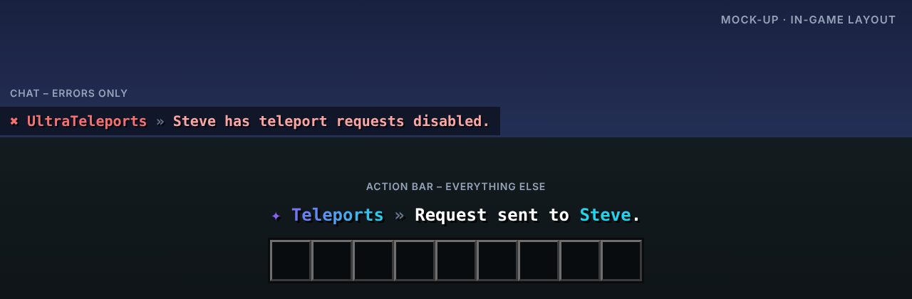

<p align="center"></p>

# UltraTeleports

> Anfragen, Random-Teleport & Back in einem Plugin.

UltraTeleports bündelt alle Spieler-Teleports: TPA-Anfragen, sicherer Random-Teleport, /back und die klassischen Team-Befehle.

Teil der [Ultra-Serie](../README.md). Layout, Farben und Verhalten folgen dem gemeinsamen
[Design-System](../DESIGN.md).

## Features

- TPA und TPAHere mit Ablaufzeit und klickbarer Annahme
- /back zum letzten Ort oder Todespunkt
- Random-Teleport mit asynchroner, sicherer Positionssuche pro Welt
- Anfragen ausschalten (/tptoggle) und einzelne Spieler ignorieren
- Warmup, Cooldown pro Teleport-Art und optionale RTP-Kosten (Vault / UltraEconomy)
- Team-Befehle: /tp, /tphere, /tpall

## Befehle

| Befehl | Beschreibung | Permission |
| --- | --- | --- |
| `/tpa <spieler>` | Teleport-Anfrage senden | `ultrateleports.tpa` |
| `/tpahere <spieler>` | Spieler zu sich anfragen | `ultrateleports.tpahere` |
| `/tpaccept · /tpdeny` | Anfrage annehmen / ablehnen | `ultrateleports.tpa` |
| `/back` | Zurück zum letzten Ort | `ultrateleports.back` |
| `/rtp [welt]` | Zufälliger Teleport | `ultrateleports.rtp` |
| `/tptoggle` | Anfragen an/aus | `ultrateleports.toggle` |
| `/tpignore <spieler>` | Anfragen eines Spielers ignorieren | `ultrateleports.toggle` |
| `/tp · /tphere · /tpall` | Team-Teleports | `ultrateleports.staff` |
| `/ultrateleports <help|reload|version|language>` | Verwaltung | `ultrateleports.admin` |

## Weitere Permissions

| Permission | Beschreibung |
| --- | --- |
| `ultrateleports.bypass.warmup` | Kein Warmup |
| `ultrateleports.bypass.cooldown` | Kein Cooldown |
| `ultrateleports.*` | Alle Rechte des Plugins |

## Ingame-Layout



Rückmeldungen erscheinen in der Actionbar, Fehler im Chat. Auszug aus `lang/en.yml`:

```yaml
request-sent: "Request sent to <accent>Steve</accent>."
rtp-searching: "Searching a safe location…"
requests-disabled: "Steve has teleport requests disabled."
```

Das Präfix (`✦ Teleports »` bzw. `✖ UltraTeleports »`) setzt das Plugin automatisch davor.

## Sprachen

Englisch, Deutsch, Französisch, Niederländisch und Italienisch sind eingebaut
(`plugins/UltraTeleports/lang/en.yml`, `de.yml`, `fr.yml`, `nl.yml`, `it.yml`).

- Jeder Spieler bekommt das Plugin in der Sprache seines Minecraft-Clients
  (`use-client-language: true`). Andere Client-Sprachen erhalten die Standardsprache.
- Standardsprache ändern: `language: de` in der `config.yml` oder im Spiel `/ultrateleports language de`.
- Texte lassen sich in den Sprachdateien frei anpassen (MiniMessage). Neue Schlüssel aus Updates
  werden automatisch ergänzt, eigene Änderungen bleiben erhalten.

## Installation

1. `UltraTeleports-1.0.0.jar` in den Ordner `plugins` legen (Spigot, Paper oder Purpur ab 1.20.4, Java 17+).
   Weitere Plugins oder Bibliotheken werden nicht benötigt.
2. Server neu starten.
3. `config.yml` und die Sprachdateien anpassen, dann `/ultrateleports reload`.

Bauen aus dem Quellcode: im Hauptordner `mvn package`, die Jar liegt danach in `UltraTeleports/target/`.

## Dateien in diesem Ordner

| Datei | Inhalt |
| --- | --- |
| `assets/logo.svg` · `logo.png` | Logo (512 × 512, Resource-Icon auf SpigotMC) |
| `assets/banner.svg` · `banner.png` | Banner (1920 × 480) |
| `assets/preview.png` | Mock-up des Ingame-Layouts |
| `spigot/description.bbcode` | Fertige SpigotMC-Beschreibung |
| `src/` | Quellcode, Konfiguration und Sprachdateien |

## Serie

[UltraSpawn](../UltraSpawn) · [UltraPunish](../UltraPunish) · [UltraHomes](../UltraHomes) · [UltraWarps](../UltraWarps) · [UltraChat](../UltraChat) · [UltraEconomy](../UltraEconomy) · [UltraKits](../UltraKits) · [UltraVanish](../UltraVanish) · [UltraReports](../UltraReports)
