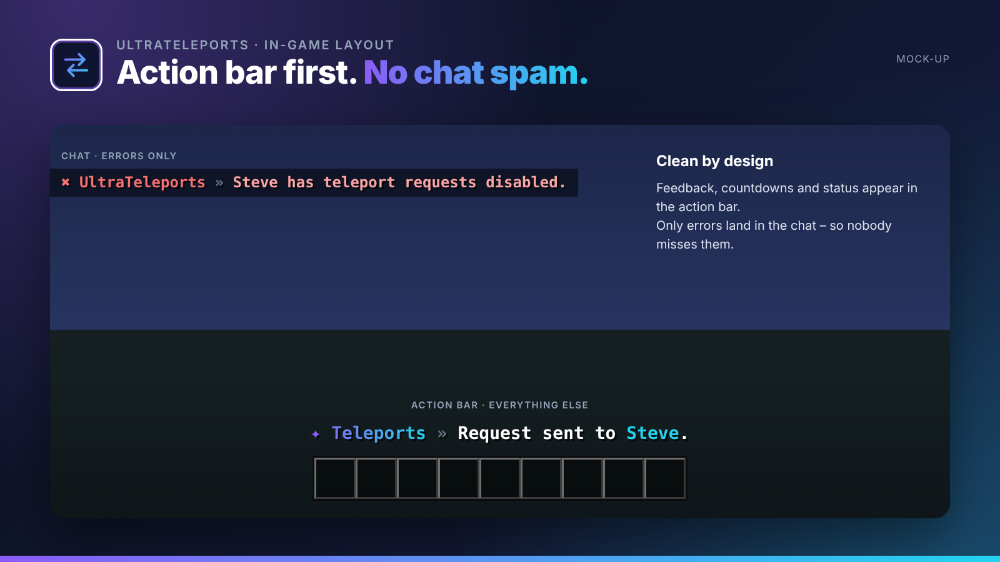

## Requests, random teleport & back in one plugin.

UltraTeleports bundles every player teleport: TPA requests, safe random teleport, /back and the classic staff commands.

UltraTeleports is part of the **UltraPlugins** series: every plugin shares the same colours, the same message layout and the same command structure.

## Features

- TPA and TPAHere with expiry and click-to-accept
- /back to your last location or death point
- Random teleport with async, safe location search per world
- Disable requests (/tptoggle) and ignore single players
- Warm-up, cooldown per teleport type and optional RTP costs (Vault / UltraEconomy)
- Staff commands: /tp, /tphere, /tpall

## In-game layout

No chat spam. Every confirmation, countdown and status appears in the **action bar**. Only **errors** are sent to the chat, so players never miss them. All messages use MiniMessage and can be edited in the language files.

## Languages

**English · Deutsch · Français · Nederlands · Italiano**

Every player sees UltraTeleports in the language of their Minecraft client – automatically. Players with any other language get your default language, which you set in the config or with `/ultrateleports language <code>`. All texts live in `lang/<code>.yml` and can be edited freely.

## Commands

| Command | Description | Permission |
| --- | --- | --- |
| `/tpa <spieler>` | Send a teleport request | `ultrateleports.tpa` |
| `/tpahere <spieler>` | Request a player to come to you | `ultrateleports.tpahere` |
| `/tpaccept · /tpdeny` | Accept / deny a request | `ultrateleports.tpa` |
| `/back` | Return to your last location | `ultrateleports.back` |
| `/rtp [welt]` | Random teleport | `ultrateleports.rtp` |
| `/tptoggle` | Toggle incoming requests | `ultrateleports.toggle` |
| `/tpignore <spieler>` | Ignore one player's requests | `ultrateleports.toggle` |
| `/tp · /tphere · /tpall` | Staff teleports | `ultrateleports.staff` |
| `/ultrateleports <help|reload|version|language>` | Administration | `ultrateleports.admin` |

## Permissions

| Permission | Description |
| --- | --- |
| `ultrateleports.bypass.warmup` | Skip the warm-up |
| `ultrateleports.bypass.cooldown` | Skip the cooldown |
| `ultrateleports.*` | Everything |

## Installation

1. Drop `UltraTeleports-1.0.0.jar` into your `plugins` folder. Works on Spigot, Paper and Purpur 1.20.4+ (Java 17+), no dependencies needed.
2. Restart your server.
3. Adjust `config.yml` and the files in `lang/`, then run `/ultrateleports reload`.

## The Ultra series

- **UltraSpawn** – Spawn management done right.
- **UltraPunish** – Clean moderation with GUI, templates & history.
- **UltraHomes** – Set, manage and share homes in one GUI.
- **UltraWarps** – Server & player warps with categories.
- **UltraChat** – Formatting, channels & moderation for your chat.
- **UltraEconomy** – Fast, Vault-ready economy with multiple currencies.
- **UltraKits** – Kits with previews, cooldowns & in-game editor.
- **UltraVanish** – True invisibility for your staff team.
- **UltraReports** – Player reports with a staff GUI workflow.

## Support

Found a bug or have an idea? Please open a report instead of leaving a bad review – we answer every request.
