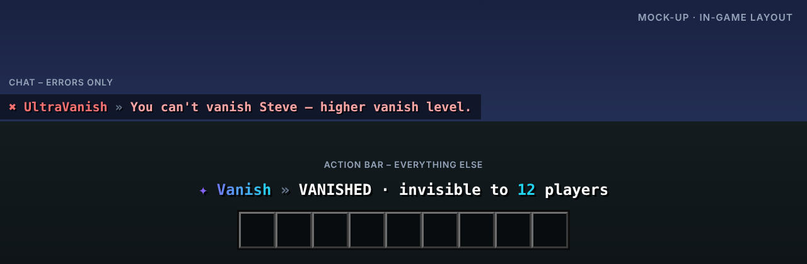

<p align="center"></p>

# UltraVanish

> Echte Unsichtbarkeit für dein Team.

UltraVanish versteckt Teammitglieder vollständig: aus der Tabliste, der Spielerzahl und der Welt. Solange man unsichtbar ist, zeigt die Actionbar dauerhaft den Status an.

Teil der [Ultra-Serie](../README.md). Layout, Farben und Verhalten folgen dem gemeinsamen
[Design-System](../DESIGN.md).

## Features

- Vollständig unsichtbar: Tabliste, Spielerzahl, Join- und Quit-Nachrichten
- Kisten lautlos und ohne Animation öffnen
- Kein Mob-Targeting, kein Item-Aufheben, keine Druckplatten
- Dauerhafte Status-Anzeige in der Actionbar
- Vanish-Level: höhere Ränge sehen niedrigere
- Fake-Join und Fake-Quit

## Befehle

| Befehl | Beschreibung | Permission |
| --- | --- | --- |
| `/vanish [spieler]` | Vanish an/aus (andere: ultravanish.vanish.others) | `ultravanish.vanish` |
| `/vanishlist` | Zeigt unsichtbare Spieler | `ultravanish.list` |
| `/fakejoin · /fakequit` | Sendet eine Fake-Nachricht | `ultravanish.fake` |
| `/ultravanish <help|reload|version|language>` | Verwaltung | `ultravanish.admin` |

## Weitere Permissions

| Permission | Beschreibung |
| --- | --- |
| `ultravanish.level.<n>` | Vanish-Level |
| `ultravanish.see` | Sieht unsichtbare Spieler |
| `ultravanish.*` | Alle Rechte des Plugins |

## Ingame-Layout



Rückmeldungen erscheinen in der Actionbar, Fehler im Chat. Auszug aus `lang/en.yml`:

```yaml
vanish-status: "VANISHED · invisible to <accent>12</accent> players"
vanish-off: "You are visible again."
target-higher-level: "You can't vanish Steve – higher vanish level."
```

Das Präfix (`✦ Vanish »` bzw. `✖ UltraVanish »`) setzt das Plugin automatisch davor.

## Sprachen

Englisch, Deutsch, Französisch, Niederländisch und Italienisch sind eingebaut
(`plugins/UltraVanish/lang/en.yml`, `de.yml`, `fr.yml`, `nl.yml`, `it.yml`).

- Jeder Spieler bekommt das Plugin in der Sprache seines Minecraft-Clients
  (`use-client-language: true`). Andere Client-Sprachen erhalten die Standardsprache.
- Standardsprache ändern: `language: de` in der `config.yml` oder im Spiel `/ultravanish language de`.
- Texte lassen sich in den Sprachdateien frei anpassen (MiniMessage). Neue Schlüssel aus Updates
  werden automatisch ergänzt, eigene Änderungen bleiben erhalten.

## Installation

1. `UltraVanish-1.0.0.jar` in den Ordner `plugins` legen (Paper 1.20.4 oder neuer, Java 17+).
2. Server neu starten.
3. `config.yml` und die Sprachdateien anpassen, dann `/ultravanish reload`.

Bauen aus dem Quellcode: im Hauptordner `mvn package`, die Jar liegt danach in `UltraVanish/target/`.

## Dateien in diesem Ordner

| Datei | Inhalt |
| --- | --- |
| `assets/logo.svg` · `logo.png` | Logo (512 × 512, Resource-Icon auf SpigotMC) |
| `assets/banner.svg` · `banner.png` | Banner (1920 × 480) |
| `assets/preview.png` | Mock-up des Ingame-Layouts |
| `spigot/description.bbcode` | Fertige SpigotMC-Beschreibung |
| `src/` | Quellcode, Konfiguration und Sprachdateien |

## Serie

[UltraSpawn](../UltraSpawn) · [UltraTeleports](../UltraTeleports) · [UltraPunish](../UltraPunish) · [UltraHomes](../UltraHomes) · [UltraWarps](../UltraWarps) · [UltraChat](../UltraChat) · [UltraEconomy](../UltraEconomy) · [UltraKits](../UltraKits) · [UltraReports](../UltraReports)
