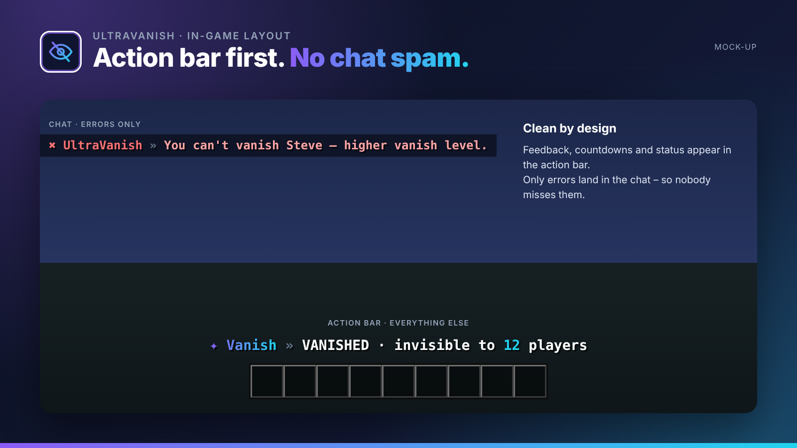
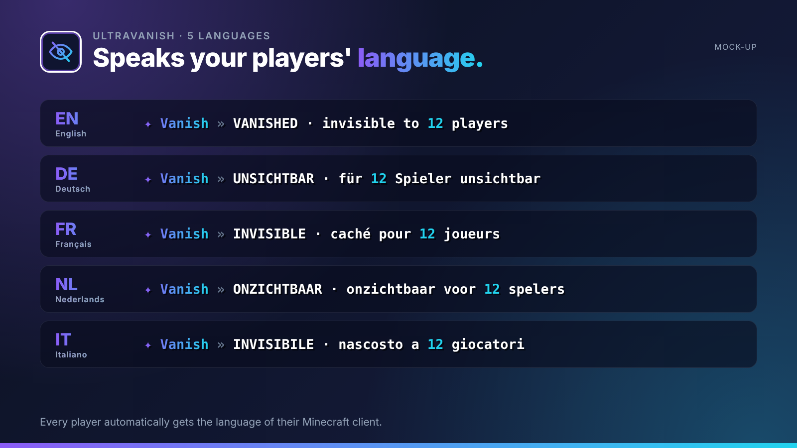
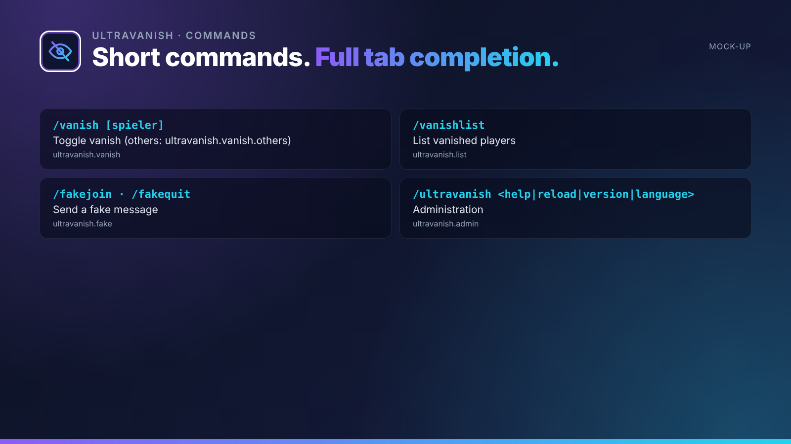

## True invisibility for your staff team.

UltraVanish hides staff members completely: from the tab list, the player count and the world. While vanished, the action bar permanently shows your status.

UltraVanish is part of the **UltraPlugins** series: every plugin shares the same colours, the same message layout and the same command structure.

## Features

- Completely invisible: tab list, player count, join and quit messages
- Open chests silently and without animation
- No mob targeting, no item pickup, no pressure plates
- Persistent status indicator in the action bar
- Vanish levels: higher ranks see lower ones
- Fake join and fake quit

## In-game layout

No chat spam. Every confirmation, countdown and status appears in the **action bar**. Only **errors** are sent to the chat, so players never miss them. All messages use MiniMessage and can be edited in the language files.

## Languages

**English · Deutsch · Français · Nederlands · Italiano**

Every player sees UltraVanish in the language of their Minecraft client – automatically. Players with any other language get your default language, which you set in the config or with `/ultravanish language <code>`. All texts live in `lang/<code>.yml` and can be edited freely.

## Commands

| Command | Description | Permission |
| --- | --- | --- |
| `/vanish [spieler]` | Toggle vanish (others: ultravanish.vanish.others) | `ultravanish.vanish` |
| `/vanishlist` | List vanished players | `ultravanish.list` |
| `/fakejoin · /fakequit` | Send a fake message | `ultravanish.fake` |
| `/ultravanish <help|reload|version|language>` | Administration | `ultravanish.admin` |

## Permissions

| Permission | Description |
| --- | --- |
| `ultravanish.level.<n>` | Vanish level |
| `ultravanish.see` | See vanished players |
| `ultravanish.*` | Everything |

## Supported versions

| | |
| --- | --- |
| Minecraft | **1.20.4 – 26.3** |
| Server | Paper and Purpur |
| Java | 17+ (whatever your Minecraft version needs) |

## Installation

1. Drop `UltraVanish-1.0.0.jar` into your `plugins` folder. Works on Paper and Purpur **1.20.4 – 26.3**, no dependencies needed.
2. Restart your server.
3. Adjust `config.yml` and the files in `lang/`, then run `/ultravanish reload`.

## The Ultra series

- **UltraSpawn** – Spawn management done right.
- **UltraTeleports** – Requests, random teleport & back in one plugin.
- **UltraPunish** – Clean moderation with GUI, templates & history.
- **UltraHomes** – Set, manage and share homes in one GUI.
- **UltraWarps** – Server & player warps with categories.
- **UltraChat** – Formatting, channels & moderation for your chat.
- **UltraEconomy** – Fast, Vault-ready economy with multiple currencies.
- **UltraKits** – Kits with previews, cooldowns & in-game editor.
- **UltraReports** – Player reports with a staff GUI workflow.

## Support

Found a bug or have an idea? Please open a report instead of leaving a bad review – we answer every request.
