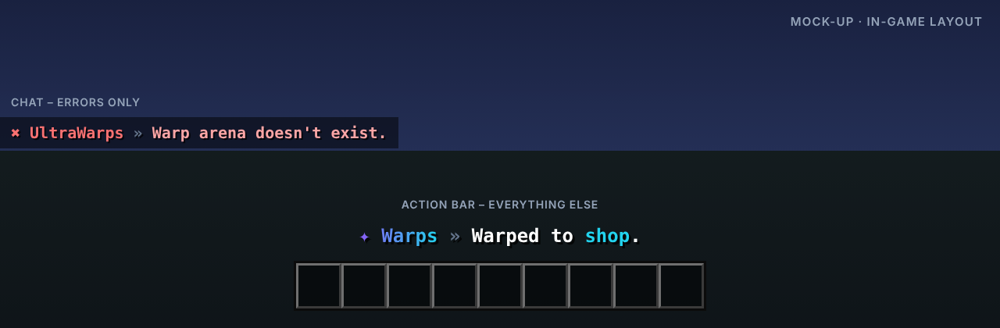

<p align="center"></p>

# UltraWarps

> Server- und Spieler-Warps mit Kategorien.

UltraWarps bringt Server-Warps in eine GUI mit Kategorien und Icons. Optional dürfen Spieler eigene Warps erstellen, zum Beispiel für ihren Shop.

Teil der [Ultra-Serie](../README.md). Layout, Farben und Verhalten folgen dem gemeinsamen
[Design-System](../DESIGN.md).

## Features

- Warp-GUI mit Kategorie-Filter und Icons (Item in der Hand)
- Optionale Spieler-Warps mit Kosten und Besucherzähler
- Permission pro Warp möglich
- Sortierung nach Name, Beliebtheit oder Datum
- Warmup, Cooldown und Teleport-Kosten
- Import aus EssentialsX

## Befehle

| Befehl | Beschreibung | Permission |
| --- | --- | --- |
| `/warp [name]` | Teleportiert zu einem Warp | `ultrawarps.warp` |
| `/warps` | Öffnet die Warp-GUI | `ultrawarps.warp` |
| `/setwarp <name> [kategorie]` | Erstellt einen Server-Warp | `ultrawarps.set` |
| `/delwarp <name>` | Löscht einen Warp | `ultrawarps.delete` |
| `/pwarp <create|delete|list>` | Spieler-Warps | `ultrawarps.player` |
| `/ultrawarps <help|reload|version|language|import>` | Verwaltung | `ultrawarps.admin` |

## Weitere Permissions

| Permission | Beschreibung |
| --- | --- |
| `ultrawarps.warp.<name>` | Zugriff auf einen bestimmten Warp |
| `ultrawarps.player.limit.<n>` | Maximale Anzahl Spieler-Warps |
| `ultrawarps.*` | Alle Rechte des Plugins |

## Ingame-Layout



Rückmeldungen erscheinen in der Actionbar, Fehler im Chat. Auszug aus `lang/en.yml`:

```yaml
warp-teleport: "Warped to <accent>shop</accent>."
warp-created: "Warp <accent>arena</accent> created."
warp-unknown: "Warp arena doesn't exist."
```

Das Präfix (`✦ Warps »` bzw. `✖ UltraWarps »`) setzt das Plugin automatisch davor.

## Sprachen

Englisch, Deutsch, Französisch, Niederländisch und Italienisch sind eingebaut
(`plugins/UltraWarps/lang/en.yml`, `de.yml`, `fr.yml`, `nl.yml`, `it.yml`).

- Jeder Spieler bekommt das Plugin in der Sprache seines Minecraft-Clients
  (`use-client-language: true`). Andere Client-Sprachen erhalten die Standardsprache.
- Standardsprache ändern: `language: de` in der `config.yml` oder im Spiel `/ultrawarps language de`.
- Texte lassen sich in den Sprachdateien frei anpassen (MiniMessage). Neue Schlüssel aus Updates
  werden automatisch ergänzt, eigene Änderungen bleiben erhalten.

## Installation

1. `UltraWarps-1.0.0.jar` in den Ordner `plugins` legen (Spigot, Paper oder Purpur, Minecraft 1.20.4 – 26.3, Java 17+).
   Weitere Plugins oder Bibliotheken werden nicht benötigt.
2. Server neu starten.
3. `config.yml` und die Sprachdateien anpassen, dann `/ultrawarps reload`.

Bauen aus dem Quellcode: im Hauptordner `mvn package`, die Jar liegt danach in `UltraWarps/target/`.

## Dateien in diesem Ordner

| Datei | Inhalt |
| --- | --- |
| `assets/logo.svg` · `logo.png` | Logo (512 × 512, Resource-Icon auf SpigotMC) |
| `assets/banner.svg` · `banner.png` | Banner (1920 × 480) |
| `assets/preview.png` | Mock-up des Ingame-Layouts |
| `release/` | Release: `release.txt` (Titel, Versionstring, Beschreibung), Jar, Changelog, Bilder |
| `src/` | Quellcode, Konfiguration und Sprachdateien |

## Serie

[UltraSpawn](../UltraSpawn) · [UltraTeleports](../UltraTeleports) · [UltraPunish](../UltraPunish) · [UltraHomes](../UltraHomes) · [UltraChat](../UltraChat) · [UltraEconomy](../UltraEconomy) · [UltraKits](../UltraKits) · [UltraVanish](../UltraVanish) · [UltraReports](../UltraReports)
