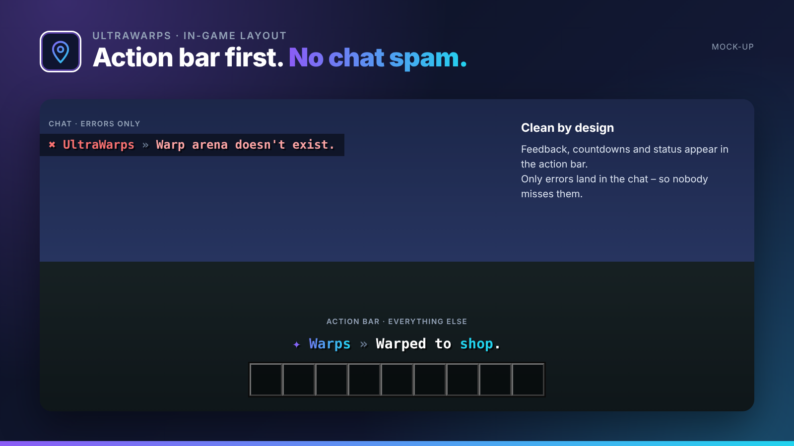

## Server & player warps with categories.

UltraWarps puts server warps into a GUI with categories and icons. Optionally players can create their own warps, for example for their shop.

UltraWarps is part of the **UltraPlugins** series: every plugin shares the same colours, the same message layout and the same command structure.

## Features

- Warp GUI with category filter and icons (item in hand)
- Optional player warps with costs and visit counter
- Optional permission per warp
- Sort by name, popularity or date
- Warm-up, cooldown and teleport costs
- Import from EssentialsX

## In-game layout

No chat spam. Every confirmation, countdown and status appears in the **action bar**. Only **errors** are sent to the chat, so players never miss them. All messages use MiniMessage and can be edited in the language files.

## Languages

**English · Deutsch · Français · Nederlands · Italiano**

Every player sees UltraWarps in the language of their Minecraft client – automatically. Players with any other language get your default language, which you set in the config or with `/ultrawarps language <code>`. All texts live in `lang/<code>.yml` and can be edited freely.

## Commands

| Command | Description | Permission |
| --- | --- | --- |
| `/warp [name]` | Teleport to a warp | `ultrawarps.warp` |
| `/warps` | Open the warp GUI | `ultrawarps.warp` |
| `/setwarp <name> [kategorie]` | Create a server warp | `ultrawarps.set` |
| `/delwarp <name>` | Delete a warp | `ultrawarps.delete` |
| `/pwarp <create|delete|list>` | Player warps | `ultrawarps.player` |
| `/ultrawarps <help|reload|version|language|import>` | Administration | `ultrawarps.admin` |

## Permissions

| Permission | Description |
| --- | --- |
| `ultrawarps.warp.<name>` | Access to a specific warp |
| `ultrawarps.player.limit.<n>` | Maximum number of player warps |
| `ultrawarps.*` | Everything |

## Supported versions

| | |
| --- | --- |
| Minecraft | **1.20.4 – 26.3** |
| Server | Spigot, Paper and Purpur |
| Java | 17+ (whatever your Minecraft version needs) |

## Installation

1. Drop `UltraWarps-1.0.0.jar` into your `plugins` folder. Works on Spigot, Paper and Purpur **1.20.4 – 26.3**, no dependencies needed.
2. Restart your server.
3. Adjust `config.yml` and the files in `lang/`, then run `/ultrawarps reload`.

## The Ultra series

- **UltraSpawn** – Spawn management done right.
- **UltraTeleports** – Requests, random teleport & back in one plugin.
- **UltraPunish** – Clean moderation with GUI, templates & history.
- **UltraHomes** – Set, manage and share homes in one GUI.
- **UltraChat** – Formatting, channels & moderation for your chat.
- **UltraEconomy** – Fast, Vault-ready economy with multiple currencies.
- **UltraKits** – Kits with previews, cooldowns & in-game editor.
- **UltraVanish** – True invisibility for your staff team.
- **UltraReports** – Player reports with a staff GUI workflow.

## Support

Found a bug or have an idea? Please open a report instead of leaving a bad review – we answer every request.
